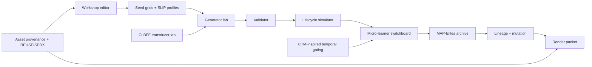
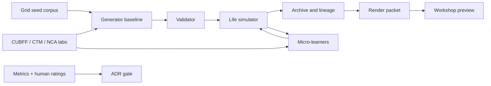
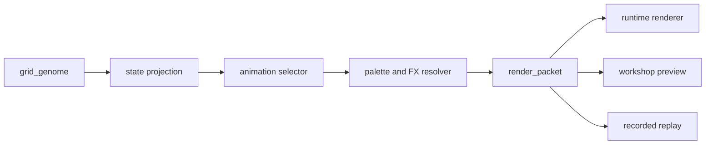

# Mechagotchi Research Dossier

## Executive summary

The strongest research framing for Mechagotchi is not “virtual pet with procedural sprites,” but a modular entity["academic_field","Artificial Life","computational study of life-like systems"] programme built on a **semantic grid genome**. In the most defensible architecture, the grid is simultaneously phenotype, mutation surface, rendering substrate, and lineage record. The evidence base favours a **hybrid stack** rather than a single algorithmic centre: local structure from a entity["scientific_concept","Markov chain","stochastic process"] or higher-order Markov model; hard validity from `Wave Function Collapse`-style constraint propagation and validators; growth and repair experiments from entity["scientific_concept","Cellular automaton","discrete dynamic system"] and neural cellular automata; evolutionary search via `MAP-Elites`; and lightweight behavioural adaptation through contextual bandits, an entity["scientific_concept","Hidden Markov Model","probabilistic sequence model"] for latent mood, and small entity["scientific_concept","Markov decision process","reinforcement learning formalism"] sandboxes. citeturn17view3turn21view0turn21view1turn9view4turn2search0turn17view1turn18view0turn4search4

The immediate recommendation is to **separate research baselines from advanced lab tracks**. The first production-grade research baseline should be: semantic grid genome → Markov/WFC hybrid generator → validator → life simulation → CPU-first `MAP-Elites` archive → render packet bridge → workshop/editor. Advanced lab tracks should then compete for admission into the core: CTM-inspired internal ticks and certainty-based adaptive compute, CUBFF/BFF semantic transduction, and neural cellular automata growth/repair. That sequencing preserves novelty while preventing the whole programme from becoming hostage to the most speculative components. citeturn1search2turn20view0turn20view1turn20view2turn20view4turn20view5turn10view0turn17view1

For the next six months, the programme should aim to answer four gating questions. First: can a formal grid genome and validator produce legible, modular, evolvable companions? Second: does a hybrid generator outperform random mutation and single-method baselines on validity, readability, and diversity? Third: does `mecha_darwin` produce a stable repertoire of different high-performing companion families rather than converging into one species? Fourth: do CUBFF and CTM concepts add enough measurable value to justify becoming first-class dependencies? Those gates are actionable, reproducible, and grounded in the source base below. citeturn24view0turn21view0turn2search0turn17view0turn10view3turn1search2

The most defensible research program for `Mechagotchi` is a staged, hybrid one: treat the grid as a formal genome and phenotype surface; use probabilistic and constraint-based generators to produce legible bodies; use a Darwinian archive to preserve diverse successful lineages; use small interpretable learners for behavior; treat `SLIP` as a schema of constraints, priors, and weights; and reserve deeper artificial-life ideas such as CuBFF and CTM-style temporal processing for carefully isolated side labs until the baseline engine is proven. That recommendation is not just aesthetic. It lines up with the strongest primary sources in this space: CTM introduces internal time and adaptive compute; Computational Life and CuBFF show that self-replicators can emerge without an explicit fitness landscape; WFC gives a mature local-pattern/constraint approach; MAP-Elites gives a diversity-preserving search model instead of one scalar optimum; and Growing Neural Cellular Automata, Lenia, and Flow-Lenia show how local update rules can support growth, regeneration, and lifelike artificial dynamics. citeturn9view3turn7view0turn9view4turn7view1turn14search3turn8view3turn7view11turn8view0turn10search3

What follows is an actionable program a small team can run: eight stages, a recommended nine-month cadence, rough staffing of about 24 person-months, formal decision gates, experiment protocols, datasets, evaluation metrics, schema examples, and a licensing/provenance system that can survive open-source scrutiny. The recommended center of gravity is **not** “largest model wins.” It is a measured stack: Markov-style local structure, WFC or SAT/SMT validation where hard constraints matter, MAP-Elites for diversity, micro-learners for narrow adaptation, and optional JAX/QDax acceleration only where the evolutionary archive actually benefits from it. citeturn8view1turn8view2turn8view6turn8view3turn7view3turn12search2turn12search6

| Decision area       | Recommended default                                       | Why                                                                  |
|---------------------|-----------------------------------------------------------|----------------------------------------------------------------------|
| Core substrate      | Semantic grid genome + validator                          | Needed before any generator or archive can be evaluated consistently |
| Default generator   | Markov + WFC/constraints + mutation                       | Strong balance of local coherence and hard validity                  |
| Evolution archive   | CPU-first `MAP-Elites`; optional QDax shadow port         | Preserve multiple species niches before optimising runtime           |
| Behaviour layer     | Rules baseline + contextual bandit + HMM mood model       | Best fit for short lifecycles and sparse feedback                    |
| Advanced lab tracks | CUBFF transducer, NCA growth, CTM-inspired internal ticks | High novelty, but must earn admission through benchmarks             |
| Authoring layer     | Semantic pixel editor + `SLIP` validator                  | Generic sprite editors do not encode mutation or survival semantics  |
| Legal posture       | Original/CC0-first assets, SPDX + REUSE in CI             | Keeps the research base reusable and auditable                       |

These defaults are the best starting point because the official PCG literature distinguishes constructive, search-based, mixed-initiative, and evaluation layers; WFC provides a precise local-constraint mechanism; MAP-Elites and QDax give a repertoire-oriented archive model; Avida and OntoAvida show the value of formal ontology plus provenance; and CTM/CUBFF each contribute strong ideas but also clear integration risk if adopted too early. citeturn27view0turn21view0turn2search0turn10view0turn17view1turn9view2turn24view0turn1search2turn10view3

## Source-backed design principles

The team should treat these as the primary references to keep open throughout the program:

| Topic | Primary sources | Why they matter |
|---|---|---|
| Temporal computation | urlCTM paperturn0search8 · urlCTM repoturn0search0 | Internal temporal axis and adaptive compute; use as inspiration for gating, not as a dependency. |
| Artificial-life substrate | urlComputational Life paperturn0search5 · urlCuBFF repoturn0search1 | Emergent self-replication without explicit fitness; relevant for lineage pressure and transducer experiments. |
| Local pattern generation | urlWaveFunctionCollapse repoturn0search2 · urlMarkovJunior repoturn12search0 | Mature example-based local-structure generation plus rewrite/constraint alternatives. |
| Search and diversity | urlMAP-Elites paperturn3search1 · urlQDax repoturn3search0 | Archive-based search over niches rather than a single “best” creature. |
| Growth and regeneration | urlGrowing NCA articleturn1search2 | Best fit for later-stage body repair, growth, scars, and pattern persistence. |
| Continuous ALife | urlLenia paperturn1search3 · urlFlow-Lenia paperturn10search3 | Useful for open-endedness research and lifelike motion, but only after the discrete grid core is stable. |
| Digital evolution discipline | urlAvida platformturn6search3 | Strong precedent for experiment controls, measurements, and lineage handling. |
| Constraint programming | urlASP for PCG paperturn6search1 · urlZ3 guideturn2search7 | Explicit design-space specification and hard constraint solving for validators. |
| Schema and validation | urlPydantic JSON Schema docsturn12search3 | Practical way to emit and validate JSON Schema from core models. |
| Licensing backbone | urlSPDX License Listturn3search3 · urlREUSE specificationturn3search15 | Machine-readable licensing, attribution, and repository hygiene. |

These sources support a layered architecture rather than a monolith. The evidence is strongest for separating **generation**, **validation**, **simulation**, **adaptation**, **evolutionary archiving**, and **authoring** into distinct modules. WFC and Markov-style systems are good at preserving local structure; ASP and SMT are good at explicit constraints; MAP-Elites is good at preserving high-performing diversity; NCA and Lenia are good at local emergence; CuBFF is good as a substrate for non-hand-authored lineage signals; and CTM is best treated as a conceptual template for internal time and confidence-based extra compute. citeturn14search3turn12search0turn9view2turn8view6turn8view3turn7view11turn8view0turn10search3turn9view4turn9view3



The architectural rule that should be written into the repository from day one is: **external novelty must be mediated through a semantic compiler**. In practice that means CuBFF tapes do not become pixels directly, and NCA/Lenia fields do not become shipping sprites directly. They become structured latent or trait signals that are then compiled into a grid genome under `SLIP` and validator control. That single rule is the best protection against the “interesting theory, unreadable output” failure mode you already encountered. citeturn9view4turn7view11turn8view0turn10search3

## Assumptions and operating model

This dossier assumes **open-ended constraints**, but it still needs a working baseline. The practical planning assumption is a core team of four to six roles, whether filled by four people or by fewer people wearing multiple hats: Research Lead, Applied Math / ALife Researcher, Engine Architect, Visual Systems Designer, Workshop / Tooling Designer, and Licensing / Provenance Maintainer. It also assumes that reproducibility is non-negotiable: every experiment should capture dataset version, Git SHA, seed, config hash, metric outputs, and artefact manifest, following the same general logic that makes OntoAvida useful for inference, provenance, and reproducibility, and that REUSE/SPDX make machine-readable licensing practical. citeturn24view0turn10view8turn13view2turn10view9

| Assumption           | Working default                                                                        |
|----------------------|----------------------------------------------------------------------------------------|
| Runtime languages    | Python 3.12 for research labs; Python engine core first; TypeScript/React for workshop |
| Experiment packaging | `research/`, `labs/`, `packages/`, `data/`, `docs/adr/`, `ops/assets/`                 |
| Reproducibility      | fixed RNG seeds, JSONL metrics, Docker/conda manifests, dataset versioning             |
| Compute tier low     | laptop/desktop CPU, 16–32 GB RAM                                                       |
| Compute tier medium  | single consumer GPU or 16-core CPU workstation                                         |
| Compute tier high    | multi-GPU or cloud JAX/CUDA budget                                                     |
| Source policy        | primary/official sources first; reimplement from papers/repos before integrating       |
| Asset policy         | original or CC0 by default; copyleft/share-alike isolated into optional sandboxes      |
| Review cadence       | weekly literature/experiment review; monthly ADR decision gate                         |

The operating model should be **schema-first and experiment-first**. That means no subsystem graduates into `packages/` until it has a written experiment card, a baseline, a metric report, and an Architecture Decision Record. QDax’s separation of `container`, `emitter`, and `scoring_function` is a strong model for how `mecha_darwin` should be decomposed; OntoAvida demonstrates the payoff of an explicit vocabulary; and the PCG literature is clear that generator evaluation must be treated as a first-class part of the field rather than an afterthought. citeturn10view0turn24view0turn27view0

The programme-wide pipeline should look like this:


That decomposition is consistent with the modular API philosophy in QDax, the provenance and reproducibility goals articulated in OntoAvida, and the multi-method framing of the PCG literature. citeturn10view0turn24view0turn17view3

### Mathematics layers to explore

| Layer | Methods to explore | Role in Mechagotchi | Priority | Main risk | Recommended stance |
|---|---|---|---|---|---|
| Local probability | first-order Markov, higher-order Markov, row n-grams, HMMs | grid birth, row continuation, pose/mood sequences, hidden mood inference | High | local coherence without global validity | Start here |
| Spatial priors | MRFs, Gibbs fields | local spatial regularity, neighborhood consistency | Medium | inference complexity, opaque debugging | Research, but do not make the first shipping generator |
| Constraint systems | WFC, SAT/SMT, ASP, shape grammars | hard validity, organ placement, symmetry, reachability of body plans | High | over-constraining novelty | Use as validator or post-generator stabilizer |
| Local emergence | CA, reaction-diffusion | damage spread, mood diffusion, growth/decay textures, sleep/heal cycles | Medium | chaotic behavior, brittle tuning | Side layer after body generator is selected |
| Learned local emergence | NCA, isotropic NCA | scar, repair, regeneration, self-maintaining motifs | Medium | training overhead, hard guarantees | Late-stage research, not stage-zero dependency |
| Continuous ALife | Lenia, Flow-Lenia | side research for lifelike motion, open-endedness, multispecies interactions | Low-to-medium | weak fit to crisp retro sprites | Use as inspiration or compiler source, not core format |
| Evolution/search | GA, novelty search, MAP-Elites, QDax | mutation, lineage exploration, niche preservation | High | wrong descriptor choices can mislead search | MAP-Elites should be the primary archive track |
| Indirect encoding | CPPN, HyperNEAT-style regularity | optional body-plan regularity and symmetry | Low-to-medium | hard integration with semantic pixels | Keep as a late exploratory generator |
| Temporal gating | CTM-inspired internal ticks, confidence gating | decision latency, extra compute for uncertain situations | Medium | overengineering | Borrow principles, not the full model |

The priorities above are evidence-backed. Rabiner’s HMM tutorial remains one of the clearest foundations for hidden-state sequence models, while Geman and Geman remain the classic spatial prior reference; WFC and MarkovJunior are concrete, modern examples of local-pattern generation and rewrite-plus-constraint propagation; ASP and SMT provide explicit, debuggable constraint handling; MAP-Elites and QDax are the clearest evolutionary archive path; NCA, Lenia, and Flow-Lenia cover the local-emergence and open-endedness side; and CTM contributes the strongest recent argument for internal-time reasoning and adaptive compute. citeturn9view0turn8view2turn14search3turn12search0turn9view2turn8view6turn8view3turn7view3turn7view11turn8view0turn10search3turn9view3

### Generator method comparison

The table below is a **planning estimate**, not an empirical result. Replace every qualitative value with measured numbers after the stage-two bake-off.

| Method | Expected validity rate | Expected readability | Expected novelty | Expected speed | Implementation complexity | Best role | Recommendation |
|---|---|---|---|---|---|---|---|
| Random baseline | Low | Low | Medium | Very high | Very low | sanity-check control | Mandatory baseline only |
| Markov variants | Medium-to-high | Medium | Medium | High | Low-to-medium | first body generator | Strong first experiment |
| WFC | High | High | Medium | Medium | Medium | local structure + constraint propagation | Strong first experiment |
| CA | Medium | Medium | High | High | Low | body growth/effect fields | secondary layer |
| NCA | Medium | High when tuned | High | Medium | High | repair/regeneration | late-stage |
| CPPN | Medium | Medium-to-high | High | Medium | High | regularity-heavy indirect encoding | optional late-stage |
| Hybrid Markov + validator | High | High | Medium-to-high | Medium | Medium | likely best core path | probable default |

WFC’s strongest advantage is that it directly enforces local pattern admissibility from examples, whereas Markov families are easier to train and debug but can drift into globally incoherent forms; CA and NCA are best understood as morphogenesis layers; and CPPNs are most attractive when regularity, symmetry, and repeated motifs matter more than strict local semantics. citeturn14search3turn12search0turn7view11turn12search9turn15search0

### Micro-learner model comparison

| Model | Best job | Pros | Cons | Keep in initial suite |
|---|---|---|---|---|
| EWMA | short-horizon trend smoothing for hunger, boredom, attention | trivial to implement, interpretable, cheap | no exploration, no hidden state | Yes |
| UCB / contextual bandit | choose small action sets such as animation or prompt timing | principled exploration/exploitation, good for sparse rewards | stationarity assumptions can break | Yes |
| Q-table | very small discrete subproblems | can learn simple policies | state explosion, needs repeated visits | Yes, but scoped tightly |
| Tiny decision tree | interpretable action routing and threshold logic | debuggable, human-readable | brittle if overfit | Yes |
| Bayesian counter / Beta-Bernoulli tracker | estimate event probabilities and uncertainty | uncertainty-aware, tiny state | limited expressivity | Yes |
| HMM | infer hidden mood from visible signals | good bridge between hidden state and visible behavior | more parameters, needs careful design | Optional, targeted only |

The reason to keep the learner set this small is that the theoretical guarantees and use cases are all strongest for narrow problems. Q-learning’s classic formulation is incremental dynamic programming over discrete action-values, and finite-time bandit analyses support simple exploration strategies under bounded reward assumptions; both are well aligned with small sub-decisions such as “which idle animation next” or “should the companion ask for attention now,” but neither justifies a giant opaque controller for the entire pet. citeturn8view8turn9view1

## Research tracks and priorities

The project should be split into nine research tracks. The table below is the operational backbone to hand to the team.

| Track | Priority | WHO | WHAT | HOW | WHERE | WHY | Deliverables | Decision gate | Rough PM |
|---|---|---|---|---|---|---|---|---|---:|
| Grid genome and validator | P0 | Research lead, engine architect, visual systems designer | Formal body/genome model | JSON Schema, invariants, validator, seed corpus | `research/grid/`, `packages/shared/` | Everything else composes on top of this | `grid_genome.schema.json`, validator, seed corpus v1 | ≥95% valid parse/validate rate on seed corpus; all default creatures render | 2.0 |
| Generator lab | P0 | Applied math researcher, engine architect | Compare body generators | Markov variants, WFC, random baseline, optional grammar/CPPN late | `labs/generator_*` | Determines how bodies are born | bake-off code, metrics dashboard, chosen baseline | One selected generator or hybrid meets validity/readability threshold | 4.0 |
| Evolution archive | P1 | Applied math researcher, ALife researcher | Preserve species diversity | GA baseline, novelty search comparison, MAP-Elites archive | `labs/archive/`, `packages/engine/darwin/` | Companion families matter more than one optimum | descriptor spec, archive code, lineage browser prototype | Archive coverage and QD score beat GA baseline | 3.0 |
| Micro-learners and switchboard | P1 | Applied ML researcher, engine architect | Narrow adaptive behaviors | EWMA, bandits, Q-tables, tiny trees, Bayesian counters, HMM where needed | `labs/learners/`, `packages/engine/learning/` | Short-lived companions need lightweight adaptivity | ablation suite, learner interfaces, switchboard | Full switchboard beats rules-only baseline in sim | 3.0 |
| `SLIP` schema and authoring | P1 | Tooling designer, engine architect, visual systems designer | Creator-facing profile system | Constraints, priors, weights, mutation permissions, preview tooling | `packages/workshop/slip/` | User authorship must shape but not break the engine | `slip.schema.json`, validator, example profiles | User-authored profiles generate valid creatures and preview consistently | 3.0 |
| CuBFF transducer lab | P2 | ALife researcher, applied math researcher | Substrate-to-grid mapping | Pipelines A–D, trait extraction, lineage features | `labs/cubff_transducer/` | Tests whether your previous failure can be solved semantically | feature extractor, four pipeline prototypes, report | Keep only if readability + novelty composite beats baseline | 2.0 |
| CA / NCA / Lenia lab | P2 | ALife researcher, visual systems designer | Growth/repair/decay layer | CA rules, NCA training, reaction-diffusion textures, Lenia side tests | `labs/ca/`, `labs/nca/`, `labs/lenia/` | Adds “living material” after body generation works | growth demos, scar/heal demo, effect field experiments | Adopt only if it adds perceived life without hurting readability | 2.5 |
| Asset pipeline and provenance | P0 | Licensing maintainer, tooling designer | Legal and reproducible asset flow | provenance ledger, REUSE, SPDX, import/export rules | `assets/`, `provenance/`, repo root | Prevents future licensing debt | YAML ledger template, CI checks, attribution manifest | CI blocks untracked external assets | 1.5 |
| Evaluation and instrumentation | P0 | Evaluation lead, engine architect | Metrics, datasets, experiments | logging schema, dashboards, human-rating protocol | `research/eval/`, `data/` | Prevents hand-wavy “looks alive” claims | metric definitions, experiment harness, data lake | All stage gates computable from reproducible logs | 3.0 |

These track assignments follow the best-supported boundaries in the literature and the available open-source tooling: classical probabilistic modeling and HMMs for sequence/hidden state, MRFs for spatial priors, explicit design-space capture with ASP, SMT validation via Z3, archive-based quality-diversity via MAP-Elites/QDax, and local self-organization via NCA/Lenia families. citeturn9view0turn8view2turn9view2turn8view6turn8view3turn7view3turn7view11turn8view0turn10search3

## Experimental program and decision gates

The stages below are deliberately front-loaded toward formalization, baselines, and evaluation. That is the only reliable way to distinguish “novel” from “merely interesting.”

| Stage | WHO | WHAT | HOW | WHERE | WHY | Deliverables | Decision gate | Rough PM |
|---|---|---|---|---|---|---|---|---:|
| Stage 0 | Research lead, engine architect | Define ontology and repository geometry | glossary, naming, schemas draft, logging spec | `docs/`, `research/`, `packages/shared/` | Prevent concept drift | glossary, repo layout, ADR template | Team can define all core objects unambiguously | 1.5 |
| Stage 1 | Research lead, applied math, ALife | Literature and source review | algorithm cards, source map, risk register | `research/source_notes/` | Ground the stack in real precedents | 25–40 algorithm cards | Every adopted method has a written rationale | 3.0 |
| Stage 2 | Applied math, visual designer | Grid genome and generator bake-off | seed corpus, validator, Markov vs WFC vs random | `labs/generator_*` | Pick the body birth pipeline | bake-off report, chosen generator | Chosen method meets thresholds | 4.5 |
| Stage 3 | Applied math, ALife | Archive and lineage lab | GA baseline, novelty baseline, MAP-Elites archive | `labs/archive/` | Prove species diversity, not only local mutation | archive prototype, descriptor map | Archive outperforms GA baseline on coverage | 3.0 |
| Stage 4 | ALife, applied math | CuBFF transducer lab | A–D pipelines, feature extraction, semantic compiler | `labs/cubff_transducer/` | Test whether substrate-level novelty survives semantic compilation | transducer report | Keep only if semantic pipelines beat direct mapping | 2.5 |
| Stage 5 | ML, engine architect | Micro-learner ablation and switchboard | EWMA/bandit/Q-table/tree/Bayes counter/HMM ablations | `labs/learners/` | Prove narrow learners add value | switchboard alpha, ablation report | Full system beats rules-only and no single learner is dead weight | 3.0 |
| Stage 6 | Tooling, visual designer, licensing | `SLIP`, workshop, and asset pipeline | schema finalization, previewer, provenance CI | `packages/workshop/`, `assets/` | Let creators author safely and legally | SLIP creator, provenance ledger, asset import rules | User-made profile path works end to end | 3.5 |
| Stage 7 | Whole team | Vertical integration and public alpha | combine chosen generator, archive, switchboard, SLIP, workshop | monorepo root | Turn research into a real engine | integrated alpha, evaluation report | Alpha reproducible from docs and CI | 3.0 |

### Markov versus WFC versus random bake-off

**Goal.** Choose the body-generation baseline.  
**Inputs.** Seed Grid Corpus v1 with 120 hand-authored creatures split 72/24/24 into train/dev/holdout; six default `SLIP` profiles; two grid sizes at 16×16 and 24×24; three fixed palettes.  
**Arms.**  
A. random mutation baseline;  
B. first/second/third-order Markov variants;  
C. WFC overlapping patterns with `N=2` and `N=3`;  
D. optional hybrid arm for observation only: Markov candidate followed by validator repair.  
**Controls.** Same holdout seeds, same validator, same render pass, same time budget, same RNG protocol.  
**Sample size.** 30 holdout seeds × 6 `SLIP`s × 100 outputs per arm = 18,000 candidates per arm, plus a human readability panel on 720 sampled outputs.  
**Metrics.** validity rate; connectedness; organ-presence F1; symmetry score; silhouette entropy; palette violation rate; generation time; descriptor novelty; human pairwise preference; mean readability score on a 1–5 rubric.  
**Statistics.** Ten fixed random seeds per arm; bootstrap 95% confidence intervals for scalar metrics; balanced pairwise human judgments analyzed with a Bradley–Terry or Elo-style preference model.  
**Decision gate.** Select the simplest arm that reaches at least 95% validity, at least 3.5/5 readability, and no more than 15% novelty loss versus the most novel arm, with median generation time below 250 ms for 16×16 CPU generation. If no single arm clears all thresholds, adopt the hybrid baseline. The reason to structure it this way is that WFC and related pattern-based generators optimize local admissibility, while Markov families optimize simplicity and controllability; the test must therefore reward both validity and legibility instead of novelty alone. citeturn14search3turn12search0turn9view0turn8view2

### MAP-Elites archive test

**Goal.** Determine whether `mecha_darwin` should be archive-based.  
**Inputs.** The winning stage-two generator; a mutation operator set; a lifecycle simulator; and three descriptor axes in the first pass: symmetry, visual complexity, and neediness.  
**Comparators.**  
A. Genetic algorithm baseline, population 256;  
B. novelty-search baseline using k-nearest-neighbor descriptor novelty;  
C. MAP-Elites with 8×8×8 niches;  
D. optional QDax replication if JAX acceleration is available.  
**Budget.** 50,000 evaluations per run, ten random seeds per comparator.  
**Metrics.** archive coverage; QD score; best fitness; invalid offspring rate; lineage depth; descriptor dispersion; extinction frequency; replayable species diversity; wall-clock cost.  
**Decision gate.** Keep MAP-Elites if it yields at least 25% greater archive coverage than GA at the same budget while keeping best-fitness within 10% of the strongest comparator, and if the resulting archive is visually and behaviorally diverse enough that a human evaluator can reliably distinguish at least five recurrent families. MAP-Elites is well suited here because the original paper is explicitly about illuminating search spaces through elites per niche, and QDax provides a modern accelerated implementation path for archive experiments. citeturn8view3turn7view3turn12search2turn12search6

### CuBFF transducer pipelines

**Goal.** Test whether substrate-level computational life can improve Mechagotchi without destroying readability.  
**Shared source corpus.** Twenty CuBFF runs, sampled across pre-replication, emergent replication, stable lineage, and collapse phases, producing a curated corpus of 400 source states.  
**Pipeline A.** Tape/instruction bytes → direct pixels. This is the intentionally weak baseline.  
**Pipeline B.** Tape statistics → trait vector → grid genome. Statistics include entropy, motif counts, replication rate, instruction diversity, program-length moments, and neighborhood locality.  
**Pipeline C.** Lineage dynamics → mutation weights. Dominance turnover, collapse events, and mutation-survival rates modify mutation probabilities in the ordinary Mechagotchi generator rather than dictating body form directly.  
**Pipeline D.** Hybrid semantic compiler. CuBFF features condition a trait vector; the ordinary generator produces candidate grids; `SLIP` and the validator enforce semantic constraints; the archive treats the result like any other lineage.  
**Controls.** Same source-state corpus, same `SLIP` family, same grid size, same validator, same render rules.  
**Metrics.** readability; human preference; novelty; lineage continuity; survival age in simulator; invalid output rate; `SLIP` alignment; ancestor recognizability.  
**Human study.** 12–20 raters, blind pairwise comparison against ordinary mutation baseline.  
**Decision gate.** Retain only B, C, or D if paired human preference exceeds 60% over A and ordinary mutation, invalid rate stays below 10%, and the composite of readability + survival + novelty improves by at least 10%. Computational Life and CuBFF justify this track because they demonstrate the emergence of self-replicating programs in simple computational substrates without an explicit objective landscape, but they do **not** imply that raw substrate state is a good human-facing phenotype. citeturn9view4turn7view1

### Micro-learner ablation

**Goal.** Determine which lightweight learners truly improve companion behavior.  
**Simulator setup.** Five synthetic user models: attentive, neglectful, erratic, punitive, and exploratory. 500 lifecycles per user model per ablation condition.  
**Conditions.**  
A. rules only;  
B. full switchboard;  
C. full minus EWMA;  
D. full minus bandit;  
E. full minus Q-table;  
F. full minus tiny tree;  
G. full minus Bayesian counter;  
H. optional full minus HMM if hidden mood is used.  
**Metrics.** lifetime; survival-score variance; user-interruption rate; action regret; boredom prediction error; hidden-mood prediction accuracy when applicable; reward per interaction; annoyance proxy; days-to-stable routine.  
**Decision gate.** Keep a learner only if its removal causes at least a 5% decline in one target metric *without* improving another more important metric, or if the learner demonstrably reduces variance/annoyance enough to justify its complexity. Bandits and Q-learning are supported by classic analyses, but the intended use here is narrow and modular, not broad-brain control. citeturn9view1turn8view8

### Statistical and protocol standards

All experiments should share a protocol appendix with fixed RNG seeds, version-locked dependencies, declared train/dev/holdout splits, benchmark hardware, and a one-page “threats to validity” note. Human judgment tasks should use blind pairwise comparisons rather than open-ended aesthetic scoring whenever possible, because pairwise forced choice is less sensitive to rater calibration drift. Every decision gate should be recorded in a lightweight architecture decision record with one of four verbs: **adopt**, **defer**, **watch**, or **reject**.

## Prioritized sources and mathematical stack

### Priority source pack

- urlContinuous Thought Machines paperturn1search2 and urlCTM repoturn1search1 — highest-value source for internal ticks, certainty-gated adaptive compute, and temporal neural dynamics. Use as conceptual inspiration for companion “thinking time,” not as a blocking dependency for v0 research.
- urlComputational Life paperturn0search9 and urlCuBFF repoturn0search1 — highest-value source for self-replication without an explicit fitness landscape, self-modification dynamics, and artificial-life substrate experiments. Use in a dedicated transducer lab, not as direct visual output.
- urlAvida official siteturn0search10, urlAvida repoturn0search2, and urlOntoAvida paperturn11search13 — core references for digital evolution, experiment formalization, and ontology/provenance design.
- urlWaveFunctionCollapse repoturn0search3 — highest-value source for single-example local pattern extraction, low-entropy collapse, contradiction handling, and time-axis constraint ideas.
- urlGrowing Neural Cellular Automata articleturn2search11 and urlGrowing NCA repoturn2search7 — strongest source for growth, regeneration, and locally updated morphology.
- urlMAP-Elites paperturn2search0, urlQDax JMLR paperturn12search7, urlQDax repoturn3search0, and urlQDax docsturn3search18 — core source pack for the `mecha_darwin` repertoire and the scaling path from CPU baseline to accelerator-backed QD.
- urlNovelty Search paperturn11search2 — baseline source for deceptive-search avoidance and open-ended exploration.
- urlPCG Bookturn15search0 — field map for constructive generation, search-based PCG, grammars, mixed-initiative tooling, and generator evaluation.
- urlSPDX License Listturn7search0, urlREUSE Softwareturn6search11, urlCreative Commons Chooserturn6search7, and urlOpenGameArt FAQturn7search3 — required source pack for provenance and licence hygiene.
- urlPixelorama repoturn6search1, urlPiskel repoturn6search0, urlLibreSprite repoturn6search2, urlLPC style guideturn8search1, urlLPC asset repoturn8search18, and urlLospec Palette Listturn6search3 — workshop/editor and asset-style references only; not all are safe to embed directly.

These are the official or primary materials most worth anchoring the programme to. CTM and CUBFF each come with official repos under Apache-2.0; Avida is officially distributed under LGPL and now has an ontology paper centred on provenance and reproducibility; WFC’s official repo documents the algorithm directly; the Distill growing-NCA article and code are the canonical reference pair; and QDax provides both the scholarly paper and production-facing docs/repo needed for adoption decisions. citeturn9view0turn9view1turn9view2turn24view0turn13view0turn14view0turn17view1turn9view3turn10view0

### Mathematical layers to explore

The structural layer should be benchmarked across entity["scientific_concept","Markov chain","stochastic process"] methods, entity["scientific_concept","Markov Random Field","undirected probabilistic graphical model"] variants, entity["other","Wave Function Collapse","procedural generation algorithm"],entity["scientific_concept","Cellular automaton","discrete dynamic system"], entity["other","Neural Cellular Automata","learned local morphogenesis model"], and entity["scientific_concept","Reaction-diffusion system","morphogenesis model"]. The behaviour and evolution layers should be benchmarked across entity["scientific_concept","Hidden Markov Model","probabilistic sequence model"], contextual bandits, entity["scientific_concept","Markov decision process","reinforcement learning formalism"] simulators, entity["other","MAP-Elites","quality-diversity algorithm"], and entity["other","Novelty Search","open-ended evolutionary algorithm"]. citeturn4search4turn10view6turn21view0turn9view4turn4search14turn18view0turn25search0turn2search0turn17view0

| Candidate                    | Best role in Mechagotchi                                   | Strengths                                                             | Weaknesses                                                      | Data need               | Compute / implementation difficulty |
|------------------------------|------------------------------------------------------------|-----------------------------------------------------------------------|-----------------------------------------------------------------|-------------------------|-------------------------------------|
| Markov / higher-order Markov | Local body pattern generation, animation frame transitions | Simple, data-light, easy to debug, lineage-friendly                   | Weak global coherence unless paired with constraints            | Low                     | Low                                 |
| Markov Random Field          | Grid denoising, local semantic regularization              | Strong lattice formulation, principled local dependence               | Inference cost higher than plain Markov; harder tooling         | Low–medium              | Medium                              |
| Hidden Markov Model          | Hidden mood, latent behavioural state                      | Interpretable latent states, sequence-friendly                        | Limited expressive power for rich behaviour                     | Low                     | Low–medium                          |
| Wave Function Collapse       | Hard local validity and body-plan coherence                | Learns from examples, minimal-entropy search, explicit contradictions | Can fail via contradictions; sensitive to example corpus        | Low                     | Medium                              |
| Classical CA                 | Damage spread, idle life, growth/glitch effects            | Cheap, expressive local emergence                                     | Hard to control semantically                                    | Low                     | Low                                 |
| Neural Cellular Automata     | Growth, repair, persistent morphology                      | Regeneration and learned local update rules                           | Requires training loop and stronger infra                       | Medium                  | Medium–high                         |
| Reaction–diffusion           | Ornamentation, scars, shell patterns, mood diffusion       | Strong morphogenesis intuition, visually rich                         | Weak semantic controllability for body plans                    | Low                     | Low–medium                          |
| MAP-Elites                   | Species archive and diverse elite preservation             | Preserves many good niches, excellent for “families”                  | Needs good behaviour descriptors                                | Low                     | Medium                              |
| Novelty Search               | Deceptive-search baseline, exploration booster             | Escapes objective traps, open-ended behaviour discovery               | Can drift into useless novelty without guardrails               | Low                     | Medium                              |
| QDax                         | Scaled QD execution                                        | Accelerator-backed QD, modular API                                    | Extra infra and JAX dependency; premature if semantics unstable | Low                     | Medium–high                         |
| Contextual bandits           | Small online personalization loops                         | Good for sparse reward and short horizons                             | No long-horizon planning                                        | Online interaction data | Low                                 |
| MDP / small planning sandbox | Goal arbitration and action utility                        | Explicit planning formalism, useful in toy simulators                 | Requires clean state/action model; brittle if state is vague    | Medium                  | Medium                              |

The source basis for this comparison is straightforward: Rabiner remains the standard HMM tutorial reference; Besag remains the key lattice-system reference for MRFs; Turing remains the classic morphogenesis reference for reaction-diffusion; WFC’s own repo documents the low-entropy collapse and contradiction model; Growing NCA is the canonical neural-cellular reference; MAP-Elites and Novelty Search are the canonical QD/open-ended search papers; and Sutton–Barto plus Li et al. cover the MDP and contextual-bandit foundations. citeturn4search4turn10view6turn4search14turn21view0turn9view4turn2search0turn17view0turn18view0turn25search0

The immediate research recommendation is therefore:

| Layer                     | Default research baseline       | Competing lab tracks                                 | Decision rule                                                           |
|---------------------------|---------------------------------|------------------------------------------------------|-------------------------------------------------------------------------|
| Body generation           | Markov + WFC/constraints        | MRF-lite post-processor, grammar layer, CA growth    | Accept the smallest stack that clears validity + readability thresholds |
| Behaviour                 | Rules + contextual bandit + HMM | CTM-inspired timing, small MDP planner               | Admit complexity only if it improves welfare or coherence materially    |
| Evolution                 | CPU MAP-Elites                  | Novelty hybrid, QDax, later NCA-assisted descriptors | Port to QDax only after descriptors and metrics stabilize               |
| Growth / repair           | none in baseline                | CA, NCA, reaction-diffusion overlays                 | Keep optional until body readability survives the layer                 |
| Artificial-life substrate | none in baseline                | CUBFF semantic transducer                            | Keep out unless transduced outputs win benchmarks                       |

This recommendation follows from the source base directly: WFC is closer to a usable generator than CTM or CUBFF; MAP-Elites is intrinsically aligned with “many species, not one optimum”; and QDax is valuable once the archive design exists, not before. citeturn21view0turn2search0turn17view1turn10view0turn20view4turn1search2

## Experimental programme

A successful programme needs a **common evaluation spine** before stage-specific work starts. The evaluation framework should combine generator metrics from the PCG literature, repertoire/archive metrics from quality-diversity, provenance metrics from OntoAvida, and user-relationship quality metrics that go beyond raw retention. In particular, machine companionship should not be reduced to “stickiness”; Banks’ recent AI-companion scale highlights relational dimensions such as Eudaimonic Exchange and Connective Coordination, which are more defensible than crude session-time optimization. citeturn27view0turn2search0turn17view1turn24view0turn23view0

| Evaluation criterion  | Primary metric                                 | Secondary metric                        | Default pass band                                    |
|-----------------------|------------------------------------------------|-----------------------------------------|------------------------------------------------------|
| Structural validity   | validator pass rate                            | false accept / false reject             | ≥ 85% generated-valid and strong validator precision |
| Visual readability    | blinded human rating                           | organ detectability, silhouette entropy | median ≥ 4/5                                         |
| Diversity             | normalized Hamming distance / archive coverage | novelty score                           | better than random and no collapse                   |
| Ancestral continuity  | parent–child trait retention                   | lineage depth                           | meaningful retention without cloning                 |
| Behavioural coherence | action oscillation rate                        | hidden-state stability                  | fewer oscillations than rules baseline               |
| Companionship quality | coordination / exchange survey items           | nuisance prompt rate                    | improves without manipulative behaviour              |
| Reproducibility       | rerun match by seed/config                     | artefact manifest completeness          | deterministic replay for research runs               |
| Licence cleanliness   | files with known licence/provenance            | CI failures                             | 100% declared in shipped artefacts                   |

The end-to-end experimental pipeline should look like this:



That structure allows each research track to compete on the same scorecard rather than being judged by aesthetics alone. citeturn17view3turn10view0turn23view0

### Grid genome

The grid-genome stage should formalize the shared vocabulary of Mechagotchi before any serious procedural or evolutionary work begins. This is where OntoAvida is the most useful analogue: its main contribution is not a specific algorithm but the explicit formalization of terms, relations, provenance, and reproducibility. Besag’s lattice formulation, WFC’s local-pattern constraints, and CA/NCA’s neighbourhood updates all become far easier to test when the grid’s semantics are explicit rather than implicit. citeturn24view0turn10view6turn21view0turn9view4

| Item           | Plan                                                                                                             |
|----------------|------------------------------------------------------------------------------------------------------------------|
| Who            | Research Lead; Engine Architect; Visual Systems Designer; Evaluation Lead                                        |
| What           | Define the genotype/phenotype contract for cells, organs, mutation permissions, palette rules, and renderability |
| How            | Schema-first design; 50 original hand-authored seeds; invalid corpus; validator; mutation fuzzing                |
| Where          | `research/grid_genome/`, `labs/grid_genome/`, `packages/mecha_engine/genome/`, `docs/ontology/`                  |
| Why            | Every later track depends on a stable, testable representation                                                   |
| Prototype spec | Python 3.12; Pydantic/JSON Schema; deterministic CLI validator; JSONL test logs                                  |
| Deliverables   | `grid_genome.schema.json`, `seed_50/`, `invalid_200/`, validator report, mutation operator spec                  |

| Experiment                                  | Inputs                                                    | Expected outputs                     | Success threshold                                      | Compute | Estimated time / effort |
|---------------------------------------------|-----------------------------------------------------------|--------------------------------------|--------------------------------------------------------|---------|-------------------------|
| Invariant definition and validator training | 50 valid hand-authored grids; 200 invalid counterexamples | validator + labelled pass/fail cases | false accept ≤ 2%; false reject ≤ 5%                   | Low     | 2 weeks / Medium        |
| Conservative mutation stability harness     | 50 seeds; 10 mutation ops; 100 offspring per seed         | mutation survival report             | ≥ 70% renderable offspring under conservative settings | Low     | 1 week / Low            |
| Human readability pilot                     | 200 grid renders; 8–10 raters                             | readability scores + comments        | median readability ≥ 4/5                               | Low     | 1 week / Low            |

This stage is successful when the rest of the programme can stop arguing about what a “valid Mechagotchi” is. WFC’s contradiction model, Besag-style lattice semantics, and OntoAvida-style explicit vocabulary make the validator the real foundation of the research stack. citeturn21view0turn10view6turn24view0

### Grid generation bake-off

The generator selection stage should compare methods under a common corpus, common metrics, and identical seed conditions. WFC’s official description is especially useful here because it makes its assumptions and failure modes explicit: pattern extraction from a single example, lowest-entropy observation, propagation, and possible contradictions. The WFC repo also notes that the overlapping model is related to higher-order Markov chains and that one dimension can be time, which makes it unusually relevant for animation and state transitions in Mechagotchi. citeturn21view0turn21view1turn21view2

| Item           | Plan                                                                                             |
|----------------|--------------------------------------------------------------------------------------------------|
| Who            | Applied Math Researcher; Engine Architect; Visual Systems Designer; Evaluation Lead              |
| What           | Benchmark random mutation, Markov, MRF-lite, WFC, grammar, CA growth, and hybrid pipelines       |
| How            | Fixed seed corpus; identical batch sizes; common metric dashboard; blinded human scoring         |
| Where          | `labs/markov_grid/`, `labs/wfc_grid/`, `labs/mrf_lite/`, `labs/grid_grammar/`, `labs/ca_growth/` |
| Why            | The project needs evidence for the default generator stack rather than ideology                  |
| Prototype spec | CPU-first Python baseline; optional external WFC reference runs; 16×16 and 24×24 targets         |
| Deliverables   | benchmark report, generator comparison notebook, chosen-stack ADR                                |

| Experiment                    | Inputs                              | Expected outputs                      | Success threshold                                                            | Compute    | Estimated time / effort |
|-------------------------------|-------------------------------------|---------------------------------------|------------------------------------------------------------------------------|------------|-------------------------|
| Generator benchmark           | `seed_50`; 1,000 outputs per method | validity/readability/diversity report | valid rate ≥ 85%; readability ≥ 3.8/5; mean generation time ≤ 250 ms on CPU  | Low–Medium | 3 weeks / Medium        |
| Animation/time-axis benchmark | state-labelled frame seeds          | valid short frame sequences           | ≥ 80% transition validity and improved frame coherence over random animation | Medium     | 1 week / Medium         |
| MRF-lite regularization test  | generator outputs + semantic maps   | post-processed candidate set          | readability uplift ≥ 0.3/5 without material diversity loss                   | Medium     | 1 week / Medium         |

The likely winner is a hybrid: Markov or higher-order local statistics for proposal generation, WFC/constraints for structural admissibility, and mutation/validator passes for lineage variation. That recommendation directly reflects the WFC repo, the PCG literature’s constructive/search distinction, and the strength of lattice-style local models in spatial systems. citeturn21view0turn17view3turn10view6

### Mecha_darwin archive

`mecha_darwin` should be researched as a repertoire, not a single-objective optimizer. The core reason is the original MAP-Elites argument: illuminating a search space is often more useful than finding one best point. QDax is especially valuable here, not because it should be adopted immediately, but because its modular `container` / `emitter` / `scoring_function` decomposition gives a clean software design for the archive and also provides a later accelerator path once the descriptors stabilize. Novelty Search should be kept in the bake-off as the canonical deceptive-search baseline. citeturn2search0turn10view0turn17view1turn17view0

| Item           | Plan                                                                                         |
|----------------|----------------------------------------------------------------------------------------------|
| Who            | Artificial Life Researcher; Applied Math Researcher; Engine Architect                        |
| What           | Build the first species archive, descriptor space, and lineage graph                         |
| How            | CPU-first MAP-Elites baseline; descriptor bake-off; novelty baseline; later QDax shadow port |
| Where          | `labs/mecha_darwin/`, `packages/mecha_engine/archive/`, `research/descriptors/`              |
| Why            | Mechagotchi’s novelty depends on preserving many viable families, not one optimum            |
| Prototype spec | Plain Python/Numpy first; archive stored as JSONL/Parquet; optional JAX/QDax mirror          |
| Deliverables   | descriptor spec, archive runner, lineage graph exporter, QD report                           |

| Experiment                  | Inputs                                | Expected outputs                            | Success threshold                                                                                                | Compute     | Estimated time / effort |
|-----------------------------|---------------------------------------|---------------------------------------------|------------------------------------------------------------------------------------------------------------------|-------------|-------------------------|
| Descriptor-space design     | generated companions + manual labels  | descriptor config candidates                | descriptor set selected with inter-rater interpretability ≥ 0.7                                                  | Medium      | 1 week / Medium         |
| MAP-Elites vs novelty vs GA | fixed generator + simulator + 5 seeds | coverage, diversity, top fitness comparison | archive coverage ≥ 25% on a 576-cell repertoire after 20k evaluations; no single lineage > 40% of occupied cells | Medium      | 2 weeks / Medium        |
| QDax shadow port            | winning descriptor config             | speed and reproducibility comparison        | ≥ 5× throughput or clearly better iteration speed before core migration                                          | Medium–High | 1 week / Medium         |

The research basis here is unusually strong: MAP-Elites provides the theory, QDax provides the modern execution model, and Novelty Search provides the required anti-deception comparator. If Mechagotchi wants “species memory,” this is the track that proves it. citeturn2search0turn17view1turn10view0turn17view0

### CUBFF transducer

CUBFF should be treated as a hidden substrate experiment, not a body generator. The `Computational Life` paper is explicit that self-replicators can arise in environments lacking an explicit fitness landscape, largely through self-modification, and that the dynamics are substrate-specific. That is potentially valuable for Mechagotchi, but your previous result already identified the main integration problem: raw CUBFF outputs are not automatically human-legible. The new research question is therefore whether CUBFF can drive **semantic traits** rather than pixels. citeturn20view3turn20view4turn20view5turn19view2

| Item           | Plan                                                                                                      |
|----------------|-----------------------------------------------------------------------------------------------------------|
| Who            | Artificial Life Researcher; Applied Math Researcher; Visual Systems Designer                              |
| What           | Test whether CUBFF/BFF dynamics can serve as a semantic transducer into Mechagotchi traits                |
| How            | Extract tape statistics, lineage events, and self-modification patterns into a trait vector               |
| Where          | `labs/cubff_transducer/`, `research/cubff_notes/`, optional isolated Docker/Nix env                       |
| Why            | This is the most novel path in the programme, but also the easiest to waste time on if left unconstrained |
| Prototype spec | local `make CUDA=0` baseline first; optional CUDA runs later; Python bindings for trait extraction        |
| Deliverables   | transducer spec, baseline comparison report, go/no-go ADR                                                 |

| Experiment                | Inputs                                                 | Expected outputs                           | Success threshold                                                                       | Compute     | Estimated time / effort |
|---------------------------|--------------------------------------------------------|--------------------------------------------|-----------------------------------------------------------------------------------------|-------------|-------------------------|
| Direct mapping baseline   | raw tape/program states                                | direct pixel or cell-role outputs          | expected to fail visually; used only as baseline                                        | Medium      | 3 days / Low            |
| Statistical transducer    | replication rate, entropy, motif counts, lineage churn | trait vector → grid genome                 | readability improves by ≥ 1 point over direct baseline                                  | Medium      | 1 week / Medium         |
| Behaviour-only transducer | CUBFF lineage events and instability signals           | mutation pressure / temperament parameters | ≥ 10% survival or novelty improvement over no-CUBFF control                             | Medium      | 1 week / Medium         |
| Hybrid semantic compiler  | CUBFF trait vector + Markov/WFC generator + validator  | final candidate population                 | must beat direct baseline on readability and either novelty or survival across 10 seeds | Medium–High | 1 week / Medium         |

The decision gate is simple: if semantic transduction does not materially beat direct mapping and baseline procedural mutation, CUBFF stays a background research note rather than part of the core engine. That protects the novelty of the project without letting novelty hijack delivery. citeturn20view4turn20view5turn19view2

### Micro-learners and switchboard

The behaviour layer should be intentionally small-model and multi-threaded. CTM’s real contribution to Mechagotchi is not “use CTM”; it is the idea that cognition can unfold over internal time and be truncated by certainty. For a short-lifecycle companion engine, that principle is more useful than copying the full model. Pair that with contextual bandits for sparse online adaptation, HMMs for latent mood, and small MDP sandboxes for action arbitration in simplified state spaces. citeturn20view0turn20view1turn20view2turn25search0turn18view0turn4search4

| Item           | Plan                                                                                                  |
|----------------|-------------------------------------------------------------------------------------------------------|
| Who            | Engine Architect; Applied ML Researcher; Evaluation Lead                                              |
| What           | Build a switchboard that combines small predictive threads instead of a monolithic “brain”            |
| How            | Start with rules baseline, then add EWMA predictors, context bandits, HMM mood, and small MDP sandbox |
| Where          | `labs/switchboard/`, `packages/mecha_engine/learning/`, `research/policies/`                          |
| Why            | Lifecycles are short, feedback is sparse, and the system must remain interpretable                    |
| Prototype spec | event-loop simulator for 100k ticks; pluggable thread interface; action logs with confidence scores   |
| Deliverables   | switchboard API, learner cards, reward specification, ablation report                                 |

| Experiment                         | Inputs                           | Expected outputs               | Success threshold                                                        | Compute    | Estimated time / effort |
|------------------------------------|----------------------------------|--------------------------------|--------------------------------------------------------------------------|------------|-------------------------|
| Rules-only baseline                | scripted scenarios + replay logs | action and nuisance baseline   | baseline established                                                     | Low        | 3 days / Low            |
| Contextual bandit action selection | context vectors + simple rewards | adaptive action preferences    | cumulative welfare reward improves ≥ 15% over rules                      | Low        | 1 week / Medium         |
| HMM mood inference                 | observed state transitions       | latent mood sequence estimates | reduced oscillation and improved state predictability                    | Low        | 1 week / Medium         |
| Small MDP sandbox                  | simplified 10–20 state world     | policy comparison              | meaningful gain only if long-horizon effects exceed bandit-only baseline | Low–Medium | 1 week / Medium         |

This track is successful if the companion feels more alive **and** becomes more interpretable. CTM justifies the internal-tick idea; Sutton–Barto justify the bandit/MDP split; and Rabiner justifies hidden-state modelling where visible needs do not fully explain action selection. citeturn20view0turn20view1turn18view1turn18view0turn4search4

### SLIP schema

`SLIP` should be treated as a mathematically meaningful profile, not a theme file. The closest useful analogue from the source base is OntoAvida’s emphasis on formal vocabulary, explicit relations, and reproducibility. In Mechagotchi terms, that means a `SLIP` object should encode constraints, priors, mutation permissions, behavioural weights, and validation rules, all under versioned schema control. The mixed-initiative and evaluation chapters in the PCG book further support making the authoring contract explicit. citeturn24view0turn27view0

| Item           | Plan                                                                                            |
|----------------|-------------------------------------------------------------------------------------------------|
| Who            | Engine Architect; Workshop Designer; Visual Systems Designer                                    |
| What           | Define the versioned `SLIP` schema, validator, and authoring affordances                        |
| How            | schema design, profile zoo, compatibility testing, creator pilot                                |
| Where          | `packages/mecha_engine/slip/`, `packages/mecha_workshop/slip_creator/`, `research/slip_schema/` |
| Why            | The project’s modularity depends on `SLIP` being both expressive and safe                       |
| Prototype spec | JSON Schema + docs + form-based editor prototype; round-trip tests with engine                  |
| Deliverables   | `slip.schema.json`, validator, 20 canonical profiles, fuzz test pack, compatibility report      |

| Experiment                       | Inputs                                   | Expected outputs               | Success threshold                                                             | Compute | Estimated time / effort |
|----------------------------------|------------------------------------------|--------------------------------|-------------------------------------------------------------------------------|---------|-------------------------|
| Constraint expressiveness test   | 20 intended species archetypes           | schema revision list           | all 20 can be represented without ad hoc fields                               | Low     | 1 week / Medium         |
| Fuzzing and invalid case testing | random profile objects + malicious cases | validator hardening report     | false pass ≤ 1% on invalid corpus                                             | Low     | 3 days / Low            |
| Creator pilot                    | 5–10 internal/external creators          | usability + schema pain points | ≥ 90% of profiles validate within two edits; ≥ 80% generate a valid companion | Low     | 1 week / Medium         |

This stage succeeds when `SLIP` becomes a stable authorial contract between workshop and engine. Without it, “modularity” remains a slogan instead of a file format. citeturn24view0turn27view0

### Workshop and editor

The workshop should be researched as a **semantic pixel editor**, not merely a canvas. That is exactly where existing open-source editors are useful as references rather than drop-in solutions. Piskel is attractive for web-first architecture because it is built in JavaScript/HTML/CSS; Pixelorama is especially relevant because it already supports project metadata and command-line automation; LibreSprite is valuable to study for onion skinning and animation UX, but its GPL lineage makes embedding more restrictive. citeturn9view7turn9view6turn9view8

| Item           | Plan                                                                                     |
|----------------|------------------------------------------------------------------------------------------|
| Who            | Workshop Designer; Visual Systems Designer; Front-end Engineer; Licensing Maintainer     |
| What           | Build a browser-first editor for semantic grids, animation states, and `SLIP` metadata   |
| How            | study existing UX; implement Mechagotchi-native semantic overlays; support import/export |
| Where          | `packages/mecha_workshop/editor/`, `research/editor_ux/`, `ops/interoperability/`        |
| Why            | Generic sprite tools cannot encode organ roles, mutation weights, or survival semantics  |
| Prototype spec | TypeScript/React + Canvas; layers; onion skin; semantic brush; metadata inspector        |
| Deliverables   | workshop alpha, usability script, round-trip test harness, interoperability report       |

| Experiment                    | Inputs                                      | Expected outputs                    | Success threshold                                | Compute | Estimated time / effort |
|-------------------------------|---------------------------------------------|-------------------------------------|--------------------------------------------------|---------|-------------------------|
| Semantic vs plain editor test | 8 participants; same authoring task         | task-time and error-rate comparison | semantic editor reduces invalid exports by ≥ 50% | Low     | 1 week / Medium         |
| Import/export fidelity test   | PNG sheets, JSON metadata, animation states | round-trip fidelity report          | 100% fidelity on canonical tests                 | Low     | 3 days / Low            |
| First-session usability study | create one creature + one `SLIP`            | usability observations              | first-time completion ≤ 45 minutes               | Low     | 1 week / Medium         |

Pixelorama and Piskel are the best immediate references for architecture and metadata practice; LibreSprite is the best animation-UX reference but should remain a study source unless the project intentionally embraces GPL obligations. citeturn9view6turn9view7turn9view8

### Asset provenance

Asset provenance is not a paperwork afterthought; it is part of the research substrate. SPDX provides standardized identifiers and canonical licence URLs, and REUSE provides a practical mechanism for file-level notices and machine-readable compliance. Creative Commons’ own chooser explicitly says CC tools are for copyrightable works and are **not** the recommended path for software, while OpenGameArt’s FAQ warns that CC-BY-SA derivatives must remain share-alike and that GPL-licensed art should be used only with very clear understanding of compatibility. LPC’s asset repo is especially instructive because it is dual-licensed under CC BY-SA 3.0 and GPL 3.0, making it useful for research sandboxes but risky as a casual default pack. citeturn13view2turn10view9turn13view3turn13view4turn9view9

| Item           | Plan                                                                                          |
|----------------|-----------------------------------------------------------------------------------------------|
| Who            | Licensing / Provenance Maintainer; Research Lead; Build Engineer                              |
| What           | Create a provenance ledger and CI gate for all external and internal assets                   |
| How            | SPDX short IDs, REUSE headers, manifest generation, optional-pack separation                  |
| Where          | `ops/assets/`, `ops/licenses/`, `data/asset_ledger/`, CI pipeline                             |
| Why            | The project needs legally legible reuse, community confidence, and reproducible asset lineage |
| Prototype spec | YAML/JSON manifest generator + CI check + attribution report exporter                         |
| Deliverables   | asset ledger, attribution generator, CI policy, optional copyleft-sandbox pack                |

| Experiment                 | Inputs                             | Expected outputs                 | Success threshold                                                  | Compute | Estimated time / effort |
|----------------------------|------------------------------------|----------------------------------|--------------------------------------------------------------------|---------|-------------------------|
| Ledger completeness test   | all imported files                 | manifest with licence/provenance | 100% shipped files declared                                        | Low     | 3 days / Low            |
| Default-pack purity test   | candidate core asset pack          | compliance report                | 0 unknown licences; no accidental copyleft assets in default build | Low     | 3 days / Low            |
| LPC sandbox isolation test | optional LPC-derived research pack | optional-pack policy             | sandbox fully isolated from default build and clearly attributed   | Low     | 3 days / Low            |

This stage is not optional. If a file cannot be traced, it cannot ship in the default build. SPDX and REUSE make that enforceable rather than aspirational. citeturn13view2turn10view9

## Data, schemas, and asset provenance

The project needs a versioned data program, not just code. The minimum dataset family should include a seed grid corpus, a held-out evaluation corpus, `SLIP` corpus, simulated lineage logs, human readability and preference judgments, CuBFF source-state snapshots, and a provenance ledger for every imported external asset. The key principle is that **evaluation data is part of the engine**. If a future contributor cannot rerun the lineage archive or confirm where a palette came from, the research program has failed. This stance is strongly aligned with the experiment culture visible in Avida and with SPDX/REUSE’s assumption that provenance and licensing should be machine-readable at repository scale. citeturn7view4turn7view5turn7view6

### Dataset program

| Dataset | Contents | Collection path | Why it exists |
|---|---|---|---|
| Seed Grid Corpus v1 | 120 hand-authored creatures with semantic labels | `data/seed_grids/` | trains and benchmarks generators |
| Holdout Grid Corpus | 24 hidden exemplars | `data/holdout_grids/` | prevents overfitting during bake-off |
| `SLIP` Corpus | 8 default profiles + adversarial invalid profiles | `data/slips/` | tests schema and validator robustness |
| Lineage Log Lake | JSONL/Parquet lifecycle and mutation logs | `data/lineages/` | powers archive metrics and regression tests |
| Human Readability Panel | pairwise preferences, readability labels, organ-detection tasks | `data/human_eval/` | tracks legibility and attachment |
| CuBFF Snapshot Corpus | selected tape/program states with lineage context | `data/cubff_snapshots/` | powers transducer experiments |
| Asset Provenance Ledger | source, creator, license, hash, modifications | `provenance/` | keeps external assets auditable |

### Evaluation metrics

The core metrics should be explicit formulas, kept in code and docs:

- **Validity rate** = `valid_outputs / total_outputs`
- **Symmetry score** = `1 - mirrored_hamming_distance / occupied_cell_count`
- **Connectedness** = fraction of occupied cells in the largest connected component
- **Organ detectability** = F1 of required organs against semantic labels
- **Readability score** = mean human rating, optionally combined with organ-detection accuracy
- **Novelty** = mean distance to `k` nearest neighbors in descriptor space
- **SLIP alignment** = weighted sum of satisfied profile constraints and preference weights
- **Survival score** = weighted lifecycle score defined by the current `SLIP`
- **Archive coverage** = occupied niches / total niches
- **QD score** = sum of elite fitness over occupied niches

Novelty search and MAP-Elites justify descriptor-space novelty and coverage as first-class measures, while HMM/MRF traditions justify separating visible outputs from hidden state and local spatial priors. citeturn8view4turn8view3turn9view0turn8view2

### SLIP and grid schema strategy

Use JSON Schema Draft 2020-12 for all on-disk schemas and emit them from typed models. urlPydantic JSON Schema docsturn12search3 confirm that Pydantic can automatically generate and customize JSON Schema and that its generated schemas target JSON Schema Draft 2020-12 and OpenAPI 3.1.0. citeturn12search3

```json
{
  "$id": "mechagotchi:grid_genome.schema.json",
  "$schema": "https://json-schema.org/draft/2020-12/schema",
  "title": "GridGenome",
  "type": "object",
  "required": ["id", "version", "grid_size", "cells", "organs", "palette"],
  "properties": {
    "id": { "type": "string", "pattern": "^[a-z0-9_\\-]+$" },
    "version": { "type": "string" },
    "grid_size": {
      "type": "array",
      "prefixItems": [
        { "type": "integer", "minimum": 8, "maximum": 64 },
        { "type": "integer", "minimum": 8, "maximum": 64 }
      ],
      "minItems": 2,
      "maxItems": 2
    },
    "cells": {
      "type": "array",
      "items": {
        "type": "object",
        "required": ["x", "y", "role", "material", "value", "mutation_weight"],
        "properties": {
          "x": { "type": "integer", "minimum": 0 },
          "y": { "type": "integer", "minimum": 0 },
          "role": {
            "type": "string",
            "enum": [
              "empty",
              "shell",
              "eye",
              "mouth",
              "joint",
              "antenna",
              "limb",
              "core",
              "ornament",
              "anchor"
            ]
          },
          "material": {
            "type": "string",
            "enum": ["void", "metal", "glass", "gel", "wire", "organic"]
          },
          "value": { "type": "integer", "minimum": 0, "maximum": 255 },
          "mutation_weight": { "type": "number", "minimum": 0.0, "maximum": 1.0 },
          "animation_anchor": { "type": "boolean", "default": false },
          "organ_id": { "type": ["string", "null"] },
          "tags": { "type": "array", "items": { "type": "string" } }
        },
        "additionalProperties": false
      }
    },
    "organs": {
      "type": "array",
      "items": {
        "type": "object",
        "required": ["id", "type", "cells"],
        "properties": {
          "id": { "type": "string" },
          "type": {
            "type": "string",
            "enum": ["sensor", "mouth", "core", "locomotion", "display", "ornament"]
          },
          "cells": {
            "type": "array",
            "items": {
              "type": "array",
              "prefixItems": [{ "type": "integer" }, { "type": "integer" }],
              "minItems": 2,
              "maxItems": 2
            }
          },
          "required": { "type": "boolean", "default": false }
        },
        "additionalProperties": false
      }
    },
    "palette": {
      "type": "object",
      "required": ["name", "colors"],
      "properties": {
        "name": { "type": "string" },
        "colors": {
          "type": "array",
          "minItems": 2,
          "maxItems": 32,
          "items": { "type": "string", "pattern": "^#[0-9A-Fa-f]{6}$" }
        }
      }
    },
    "constraints": {
      "type": "object",
      "properties": {
        "min_body_mass": { "type": "integer", "minimum": 1 },
        "max_body_mass": { "type": "integer", "minimum": 1 },
        "connected_required": { "type": "boolean", "default": true },
        "symmetry_bias": { "type": "number", "minimum": 0.0, "maximum": 1.0 }
      },
      "additionalProperties": false
    }
  },
  "additionalProperties": false
}
```

```json
{
  "$id": "mechagotchi:slip.schema.json",
  "$schema": "https://json-schema.org/draft/2020-12/schema",
  "title": "SLIP",
  "type": "object",
  "required": [
    "id",
    "version",
    "species_class",
    "grid",
    "behavior",
    "survival_weights",
    "mutation",
    "render"
  ],
  "properties": {
    "id": { "type": "string", "pattern": "^[a-z0-9_\\-]+$" },
    "version": { "type": "string" },
    "display_name": { "type": "string" },
    "species_class": { "type": "string" },
    "grid": {
      "type": "object",
      "required": ["min_size", "max_size", "allowed_roles"],
      "properties": {
        "min_size": {
          "type": "array",
          "prefixItems": [{ "type": "integer" }, { "type": "integer" }],
          "minItems": 2,
          "maxItems": 2
        },
        "max_size": {
          "type": "array",
          "prefixItems": [{ "type": "integer" }, { "type": "integer" }],
          "minItems": 2,
          "maxItems": 2
        },
        "allowed_roles": {
          "type": "array",
          "items": { "type": "string" }
        },
        "required_organs": {
          "type": "array",
          "items": { "type": "string" }
        },
        "symmetry_bias": { "type": "number", "minimum": 0, "maximum": 1 }
      },
      "additionalProperties": false
    },
    "behavior": {
      "type": "object",
      "properties": {
        "curiosity": { "type": "number", "minimum": 0, "maximum": 1 },
        "neediness": { "type": "number", "minimum": 0, "maximum": 1 },
        "sleepiness": { "type": "number", "minimum": 0, "maximum": 1 },
        "mischief": { "type": "number", "minimum": 0, "maximum": 1 },
        "sociability": { "type": "number", "minimum": 0, "maximum": 1 }
      },
      "additionalProperties": false
    },
    "survival_weights": {
      "type": "object",
      "additionalProperties": {
        "type": "number",
        "minimum": 0,
        "maximum": 1
      }
    },
    "mutation": {
      "type": "object",
      "properties": {
        "palette_shift": { "type": "number", "minimum": 0, "maximum": 1 },
        "organ_shift": { "type": "number", "minimum": 0, "maximum": 1 },
        "limb_growth": { "type": "number", "minimum": 0, "maximum": 1 },
        "symmetry_break": { "type": "number", "minimum": 0, "maximum": 1 },
        "max_edit_fraction": { "type": "number", "minimum": 0, "maximum": 1 }
      },
      "additionalProperties": false
    },
    "render": {
      "type": "object",
      "properties": {
        "palette_name": { "type": "string" },
        "effects": {
          "type": "array",
          "items": {
            "type": "string",
            "enum": ["lcd_ghosting", "scanline", "crt_bloom", "glitch", "none"]
          }
        },
        "animation_vocab": {
          "type": "array",
          "items": { "type": "string" }
        }
      },
      "additionalProperties": false
    }
  },
  "additionalProperties": false
}
```

```json
{
  "companion_id": "mx-0017",
  "frame_id": 1042,
  "mood": "curious",
  "animation": "idle_blink",
  "grid_size": [16, 16],
  "palette": "lcd_green",
  "cells": [
    { "x": 4, "y": 5, "color": "#2f3b24", "role": "eye" },
    { "x": 5, "y": 5, "color": "#6c7f57", "role": "eye" }
  ],
  "effects": ["scanline", "lcd_ghosting"],
  "ui_hints": {
    "needs_attention": false,
    "interaction_prompt": null
  }
}
```

### Asset sourcing and provenance

For licensing and attribution policy, entity["organization","Creative Commons","copyright nonprofit"] makes the boundary clear: the official urllicense chooserturn11search0 says CC licenses are for copyrightable works and does **not** recommend them for software or hardware. Pair that with the urlSPDX License Listturn3search3 and the urlREUSE specificationturn3search15 as the project’s legal backbone. SPDX provides standardized identifiers and canonical URLs for licenses, while REUSE requires that each license file live in a `LICENSES/` directory named by SPDX identifier, which is exactly the kind of machine-readable discipline Mechagotchi needs. citeturn11search0turn7view5turn7view6

For third-party art, entity["organization","OpenGameArt","asset community"] is useful as an urlasset portalturn5search0, but use it carefully. Its FAQ states that accepted free/open licenses include CC0, CC-BY, CC-BY-SA, OGA-BY, public domain, and similar terms, and it also warns that preview images or clips may **not** have the same reusable license as the downloadable asset package. The safest default policy is therefore: ship only original assets or clearly tracked CC0/compatible assets; treat previews as non-authoritative; and record every derivative step in the provenance ledger. For palette research, the urlLospec palette listturn5search1 is a strong reference because it offers a large downloadable palette database in multiple formats. For collaborative pixel-art style baselines, the urlLPC style guideturn11search34 is useful, but the materials are dual-licensed under CC BY-SA 3.0 and GPLv3-or-later, which makes them better for research and style benchmarking than for casual core-asset shipping. citeturn5search12turn11search1turn11search34turn5search1

For editor UX research, the strongest open-source references are urlPixelorama repoturn5search2, urlPiskel repoturn5search3, and urlLibreSprite repoturn5search7. Pixelorama’s official repo highlights project metadata and extensions under the MIT license; Piskel is an easy-to-use browser-oriented sprite editor under Apache-2.0; and LibreSprite is GPL-2.0, with onion skinning, tiled drawing, layers, and frame workflows that are relevant to workshop ergonomics but potentially awkward if you want to embed or reuse code in a permissively licensed monorepo. The research recommendation is to study all three, interoperate where useful, but build a Mechagotchi-native semantic editor instead of forking one wholesale. citeturn7view7turn13view5turn13view6turn13view4

```yaml
asset_id: "pal_lcd_green_001"
title: "LCD Green Test Palette"
creator: "internal"
source_name: "generated-in-house"
source_url: null
download_date: null
license: "CC0-1.0"
spdx_id: "CC0-1.0"
derivative_of: []
modifications:
  - "generated from internal palette study"
hash_sha256: "REPLACE_ME"
included_in_repo: true
usage_locations:
  - "assets/palettes/lcd_green.hex"
  - "packages/workshop/defaults/palette_presets.json"
attribution_text: null
commercial_allowed: true
redistribution_allowed: true
share_alike_required: false
notes: "Internal default palette"
```

## Team, stack, risks, and milestones

A serious version of this program is small-team feasible, but only if roles are explicit. The minimum viable team is three to four people with stable responsibilities: research lead/product owner; engine architect/simulation engineer; applied math or ML engineer; and tooling/visual systems designer. Add part-time evaluation and licensing ownership rather than assuming those duties will “just happen.” On raw staffing, the staged plan above is roughly 24 person-months. A plausible allocation is: research lead 0.4 FTE throughout, engine architect 1.0 FTE, applied math/ML 0.8 FTE, tooling/visual 0.5 FTE in stages 2 and 6–7, and a 0.2–0.3 FTE licensing/eval owner. That is still a small team, but it is large enough to keep the project from collapsing into one person’s half-documented intuition.

### Recommended stack

| Layer | Recommendation | Why |
|---|---|---|
| Core engine | Python 3.11 | fastest research iteration, best open-source accessibility |
| Data model | Pydantic 2 + JSON Schema | one source of truth for validation and schema emission |
| Simulation numerics | NumPy first, Numba optional | reliable CPU path before acceleration |
| Archive experiments | optional JAX + QDax side package | accelerate MAP-Elites/QD only when needed |
| Constraint solving | `z3-solver` Python binding | precise semantic validation and repair checks |
| Storage | SQLite + Parquet/JSONL | simple local lifecycle logs and experiment reproducibility |
| Front-end workshop | TypeScript + React + Canvas | best route to a semantic grid editor and previewer |
| Experiment notebooks | Jupyter + versioned scripts | research speed plus reproducibility |
| CI | pytest + deterministic seed tests + REUSE checks | keeps research code from drifting |
| Packaging | monorepo with `packages/`, `labs/`, `research/` | isolates disposable experiments from core code |

The stack choices above are pragmatic rather than trendy. QDax’s official repository emphasizes accelerating quality-diversity and neuroevolution through hardware accelerators and large-scale parallelization, and its docs state that it expects Python 3.11+ plus a working JAX installation. JAX itself is explicitly designed for accelerator-oriented numerical computing. That makes QDax excellent for the archive lab, but a poor fit for everything else unless and until measurement shows it is necessary. Pydantic, by contrast, is useful from day one because its JSON Schema support gives you validated contracts for genomes, `SLIP`s, render packets, and experiment logs. Z3 is the right optional adjunct wherever “this organ must exist and those cells may not overlap” needs to become a real theorem-checking problem rather than ad hoc Python if-statements. citeturn7view3turn12search2turn12search6turn12search3turn8view6

### Risk and mitigation matrix

| Choice | Main risk | Why it matters | Mitigation |
|---|---|---|---|
| Markov-only core | locally plausible but globally malformed bodies | readable pets may collapse into blobs or impossible organs | pair with validator; compare against WFC |
| WFC-only core | sample overfitting and reduced novelty | results may be coherent but repetitive | use multiple exemplars and mutation layer |
| Full CTM adoption | compute and complexity disproportionate to use case | delays core engine proof | use CTM-inspired time/confidence gating only |
| Direct CuBFF visual mapping | unreadable outputs | repeats prior failure mode | semantic transducer only |
| Early NCA/Lenia adoption | beautiful but uncontrollable dynamics | can derail body semantics | keep in side labs until baseline body generator is stable |
| GPL-heavy editor embedding | downstream licensing friction | workshop may contaminate distribution choices | study UX, prefer interoperability over code reuse |
| Missing provenance discipline | impossible future attribution cleanup | open-source credibility and release safety suffer | REUSE/SPDX CI from the first external asset |
| Wrong archive descriptors | MAP-Elites explores unhelpful niches | diversity becomes noise | benchmark descriptor set in stage three before polishing |

### Prototype milestones

| Milestone | What must exist |
|---|---|
| M0 | ontology, repo structure, logging spec |
| M1 | schema-complete grid genome + validator + seed corpus |
| M2 | generator bake-off with measured winner |
| M3 | archive prototype with visible lineage diversity |
| M4 | CuBFF transducer report with keep/defer decision |
| M5 | switchboard alpha with ablation report |
| M6 | `SLIP` editor + provenance CI + workshop preview |
| M7 | integrated alpha engine and public evaluation report |

---

The programme should prefer **internal datasets first** because they keep semantics clean and licensing simple. External sources should be added only as clearly labelled sandboxes: LPC for style/interoperability studies, Lospec for palette exploration, and editor references for UX study rather than asset ingestion. OntoAvida is the right inspiration here because it treats ontology, provenance, and experiment configuration as first-class data products rather than incidental metadata. citeturn24view0turn13view5turn13view6

| Dataset              | Purpose                              | Creation method                                    | Target size        | Format                     |
|----------------------|--------------------------------------|----------------------------------------------------|--------------------|----------------------------|
| `mechaseed_50`       | initial valid creature corpus        | fully original hand-authored seeds                 | 50 creatures       | JSON + PNG render          |
| `mechaseed_200`      | broader body-plan training/eval set  | derived from `mechaseed_50` with curated variants  | 200 creatures      | JSON + PNG                 |
| `grid_invalid_200`   | validator negative corpus            | intentionally malformed grids                      | 200 cases          | JSON                       |
| `mutationbench_5000` | mutation operator evaluation         | generated offspring from seeds under fixed configs | 5,000 cases        | JSONL                      |
| `animstate_300`      | state-frame corpus                   | curated idle/blink/sleep/beg/ill sequences         | 300 sequences      | JSON + spritesheet         |
| `slip_zoo_100`       | profile compatibility suite          | canonical `SLIP` profiles across archetypes        | 100 profiles       | JSON                       |
| `replay_100k_ticks`  | behaviour and switchboard evaluation | simulated tick logs + interaction scripts          | 100k ticks         | JSONL / Parquet            |
| `humanratings_v1`    | readability and bond evaluation      | blinded rating rounds                              | 1–2 studies        | CSV + questionnaire export |
| `asset_ledger_v1`    | provenance and attribution           | manifest generation from CI                        | full project scope | YAML / JSON                |

The render bridge should also be designed as a stable interface between back end and workshop/runtime. QDax’s modular decomposition is a useful software pattern here: generation, evaluation, and storage should be separable so the render bridge stays thin and future front ends remain swappable. citeturn10view0turn17view1



A minimal semantic grid sketch for testing should look like this:

```text
Legend: E=eye  M=mouth  S=shell  J=joint  .=empty

........
..SEES..
..SSSS..
..SSSS..
...MM...
..SJJ...
..S..S..
........
```

The design artefacts below are proposed starter schemas, not final standards.

```json
{
  "schema_version": "0.1.0",
  "grid_id": "mg_seed_001",
  "species_class": "proto_shell",
  "grid_size": [16, 16],
  "palette_id": "lcd_green_01",
  "symmetry": {
    "mode": "bilateral",
    "bias": 0.82
  },
  "cells": [
    {
      "x": 5,
      "y": 4,
      "role": "eye",
      "material": "sensor",
      "value": 1,
      "organ_id": "eye_left",
      "mutation_weight": 0.1,
      "animation_anchor": true
    },
    {
      "x": 10,
      "y": 4,
      "role": "eye",
      "material": "sensor",
      "value": 1,
      "organ_id": "eye_right",
      "mutation_weight": 0.1,
      "animation_anchor": true
    },
    {
      "x": 7,
      "y": 9,
      "role": "mouth",
      "material": "shell",
      "value": 1,
      "organ_id": "mouth",
      "mutation_weight": 0.2,
      "animation_anchor": true
    }
  ],
  "invariants": {
    "min_body_mass": 18,
    "requires_sensor_pair": true,
    "requires_animation_anchor": true,
    "connected_components_max": 1
  }
}
```

```json
{
  "schema_version": "0.1.0",
  "slip_id": "slip_rust_goblin_v1",
  "name": "Rust Goblin",
  "species_class": "goblin_mecha",
  "generator_priors": {
    "grid_size_min": [12, 12],
    "grid_size_max": [24, 24],
    "symmetry_bias": 0.7,
    "preferred_roles": ["eye", "shell", "joint", "antenna"],
    "forbidden_roles": ["wing"]
  },
  "behaviour": {
    "curiosity": 0.82,
    "neediness": 0.35,
    "sleepiness": 0.48,
    "mischief": 0.71
  },
  "survival_weights": {
    "fed": 0.2,
    "rested": 0.2,
    "clean": 0.1,
    "social": 0.15,
    "novelty": 0.15,
    "stability": 0.2
  },
  "mutation_permissions": {
    "palette_shift": 0.12,
    "organ_shift": 0.06,
    "limb_growth": 0.08,
    "symmetry_break": 0.02
  },
  "learning_toggles": {
    "allow_bandit_personalization": true,
    "allow_hidden_mood_model": true,
    "allow_archive_bias": true
  }
}
```

```json
{
  "schema_version": "0.1.0",
  "frame_id": "rp_001_000342",
  "companion_id": "mg_001",
  "tick": 342,
  "mood": "curious",
  "life_state": "idle",
  "grid_size": [16, 16],
  "palette_id": "lcd_green_01",
  "cells": [
    { "x": 5, "y": 4, "color": "#1d2b1d", "role": "eye" },
    { "x": 10, "y": 4, "color": "#1d2b1d", "role": "eye" },
    { "x": 7, "y": 9, "color": "#344c34", "role": "mouth" }
  ],
  "animation": {
    "clip": "idle_blink",
    "frame_index": 2,
    "anchors": ["eye_left", "eye_right", "mouth"]
  },
  "effects": ["scanline", "lcd_ghosting"],
  "ui_hints": {
    "show_hunger_icon": false,
    "show_sleep_icon": false,
    "show_attention_ping": true
  }
}
```

```json
{
  "schema_version": "0.1.0",
  "lineage_record_id": "lin_00921",
  "child_id": "mg_0921",
  "parent_ids": ["mg_0814", "mg_0816"],
  "generation_index": 18,
  "archive_niche": {
    "symmetry_bin": 4,
    "complexity_bin": 2,
    "neediness_bin": 1,
    "animation_bin": 3
  },
  "mutation_events": [
    { "type": "palette_shift", "delta": 0.08 },
    { "type": "organ_shift", "organ_id": "eye_left", "dx": 1, "dy": 0 }
  ],
  "survival_outcome": {
    "age_ticks": 14320,
    "death_cause": "energy_collapse",
    "fitness": 0.71,
    "user_bond": 0.64
  },
  "provenance": {
    "dataset_version": "mechaseed_200@2026-06-15",
    "config_hash": "sha256:example",
    "rng_seed": 44192
  }
}
```

```json
{
  "schema_version": "0.1.0",
  "archive_entry_id": "arc_0045_0021_0008_0012",
  "occupant_id": "mg_0921",
  "descriptor": {
    "symmetry": 0.78,
    "visual_complexity": 0.41,
    "neediness": 0.29,
    "animation_density": 0.63
  },
  "descriptor_bins": [4, 2, 1, 3],
  "fitness_components": {
    "survival": 0.74,
    "readability": 0.82,
    "novelty": 0.55,
    "bond": 0.64,
    "slip_alignment": 0.77
  },
  "fitness_total": 0.71,
  "parents": ["mg_0814", "mg_0816"],
  "created_at_tick": 987201
}
```

---
