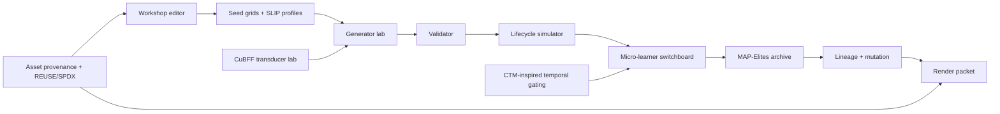
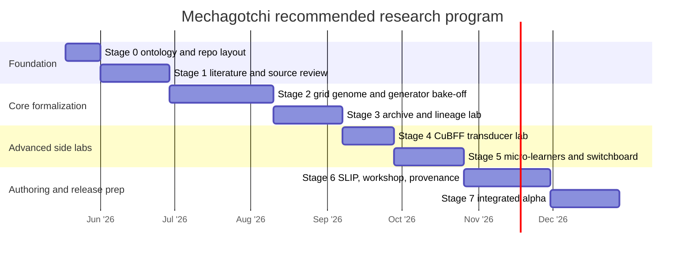

# Mechagotchi Deep Research Program - RUN TWO

## Executive summary

The most defensible research program for `Mechagotchi` is a staged, hybrid one: treat the grid as a formal genome and phenotype surface; use probabilistic and constraint-based generators to produce legible bodies; use a Darwinian archive to preserve diverse successful lineages; use small interpretable learners for behavior; treat `SLIP` as a schema of constraints, priors, and weights; and reserve deeper artificial-life ideas such as CuBFF and CTM-style temporal processing for carefully isolated side labs until the baseline engine is proven. That recommendation is not just aesthetic. It lines up with the strongest primary sources in this space: CTM introduces internal time and adaptive compute; Computational Life and CuBFF show that self-replicators can emerge without an explicit fitness landscape; WFC gives a mature local-pattern/constraint approach; MAP-Elites gives a diversity-preserving search model instead of one scalar optimum; and Growing Neural Cellular Automata, Lenia, and Flow-Lenia show how local update rules can support growth, regeneration, and lifelike artificial dynamics. citeturn9view3turn7view0turn9view4turn7view1turn14search3turn8view3turn7view11turn8view0turn10search3

What follows is an actionable program a small team can run: eight stages, a recommended nine-month cadence, rough staffing of about 24 person-months, formal decision gates, experiment protocols, datasets, evaluation metrics, schema examples, and a licensing/provenance system that can survive open-source scrutiny. The recommended center of gravity is **not** “largest model wins.” It is a measured stack: Markov-style local structure, WFC or SAT/SMT validation where hard constraints matter, MAP-Elites for diversity, micro-learners for narrow adaptation, and optional JAX/QDax acceleration only where the evolutionary archive actually benefits from it. citeturn8view1turn8view2turn8view6turn8view3turn7view3turn12search2turn12search6

## Source-backed design principles

The team should treat these as the primary references to keep open throughout the program:

| Topic | Primary sources | Why they matter |
|---|---|---|
| Temporal computation | urlCTM paperturn0search8 · urlCTM repoturn0search0 | Internal temporal axis and adaptive compute; use as inspiration for gating, not as a dependency. |
| Artificial-life substrate | urlComputational Life paperturn0search5 · urlCuBFF repoturn0search1 | Emergent self-replication without explicit fitness; relevant for lineage pressure and transducer experiments. |
| Local pattern generation | urlWaveFunctionCollapse repoturn0search2 · urlMarkovJunior repoturn12search0 | Mature example-based local-structure generation plus rewrite/constraint alternatives. |
| Search and diversity | urlMAP-Elites paperturn3search1 · urlQDax repoturn3search0 | Archive-based search over niches rather than a single “best” creature. |
| Growth and regeneration | urlGrowing NCA articleturn1search2 | Best fit for later-stage body repair, growth, scars, and pattern persistence. |
| Continuous ALife | urlLenia paperturn1search3 · urlFlow-Lenia paperturn10search3 | Useful for open-endedness research and lifelike motion, but only after the discrete grid core is stable. |
| Digital evolution discipline | urlAvida platformturn6search3 | Strong precedent for experiment controls, measurements, and lineage handling. |
| Constraint programming | urlASP for PCG paperturn6search1 · urlZ3 guideturn2search7 | Explicit design-space specification and hard constraint solving for validators. |
| Schema and validation | urlPydantic JSON Schema docsturn12search3 | Practical way to emit and validate JSON Schema from core models. |
| Licensing backbone | urlSPDX License Listturn3search3 · urlREUSE specificationturn3search15 | Machine-readable licensing, attribution, and repository hygiene. |

These sources support a layered architecture rather than a monolith. The evidence is strongest for separating **generation**, **validation**, **simulation**, **adaptation**, **evolutionary archiving**, and **authoring** into distinct modules. WFC and Markov-style systems are good at preserving local structure; ASP and SMT are good at explicit constraints; MAP-Elites is good at preserving high-performing diversity; NCA and Lenia are good at local emergence; CuBFF is good as a substrate for non-hand-authored lineage signals; and CTM is best treated as a conceptual template for internal time and confidence-based extra compute. citeturn14search3turn12search0turn9view2turn8view6turn8view3turn7view11turn8view0turn10search3turn9view4turn9view3



The architectural rule that should be written into the repository from day one is: **external novelty must be mediated through a semantic compiler**. In practice that means CuBFF tapes do not become pixels directly, and NCA/Lenia fields do not become shipping sprites directly. They become structured latent or trait signals that are then compiled into a grid genome under `SLIP` and validator control. That single rule is the best protection against the “interesting theory, unreadable output” failure mode you already encountered. citeturn9view4turn7view11turn8view0turn10search3

## Research tracks and priorities

The project should be split into nine research tracks. The table below is the operational backbone to hand to the team.

| Track | Priority | WHO | WHAT | HOW | WHERE | WHY | Deliverables | Decision gate | Rough PM |
|---|---|---|---|---|---|---|---|---|---:|
| Grid genome and validator | P0 | Research lead, engine architect, visual systems designer | Formal body/genome model | JSON Schema, invariants, validator, seed corpus | `research/grid/`, `packages/shared/` | Everything else composes on top of this | `grid_genome.schema.json`, validator, seed corpus v1 | ≥95% valid parse/validate rate on seed corpus; all default creatures render | 2.0 |
| Generator lab | P0 | Applied math researcher, engine architect | Compare body generators | Markov variants, WFC, random baseline, optional grammar/CPPN late | `labs/generator_*` | Determines how bodies are born | bake-off code, metrics dashboard, chosen baseline | One selected generator or hybrid meets validity/readability threshold | 4.0 |
| Evolution archive | P1 | Applied math researcher, ALife researcher | Preserve species diversity | GA baseline, novelty search comparison, MAP-Elites archive | `labs/archive/`, `packages/engine/darwin/` | Companion families matter more than one optimum | descriptor spec, archive code, lineage browser prototype | Archive coverage and QD score beat GA baseline | 3.0 |
| Micro-learners and switchboard | P1 | Applied ML researcher, engine architect | Narrow adaptive behaviors | EWMA, bandits, Q-tables, tiny trees, Bayesian counters, HMM where needed | `labs/learners/`, `packages/engine/learning/` | Short-lived companions need lightweight adaptivity | ablation suite, learner interfaces, switchboard | Full switchboard beats rules-only baseline in sim | 3.0 |
| `SLIP` schema and authoring | P1 | Tooling designer, engine architect, visual systems designer | Creator-facing profile system | Constraints, priors, weights, mutation permissions, preview tooling | `packages/workshop/slip/` | User authorship must shape but not break the engine | `slip.schema.json`, validator, example profiles | User-authored profiles generate valid creatures and preview consistently | 3.0 |
| CuBFF transducer lab | P2 | ALife researcher, applied math researcher | Substrate-to-grid mapping | Pipelines A–D, trait extraction, lineage features | `labs/cubff_transducer/` | Tests whether your previous failure can be solved semantically | feature extractor, four pipeline prototypes, report | Keep only if readability + novelty composite beats baseline | 2.0 |
| CA / NCA / Lenia lab | P2 | ALife researcher, visual systems designer | Growth/repair/decay layer | CA rules, NCA training, reaction-diffusion textures, Lenia side tests | `labs/ca/`, `labs/nca/`, `labs/lenia/` | Adds “living material” after body generation works | growth demos, scar/heal demo, effect field experiments | Adopt only if it adds perceived life without hurting readability | 2.5 |
| Asset pipeline and provenance | P0 | Licensing maintainer, tooling designer | Legal and reproducible asset flow | provenance ledger, REUSE, SPDX, import/export rules | `assets/`, `provenance/`, repo root | Prevents future licensing debt | YAML ledger template, CI checks, attribution manifest | CI blocks untracked external assets | 1.5 |
| Evaluation and instrumentation | P0 | Evaluation lead, engine architect | Metrics, datasets, experiments | logging schema, dashboards, human-rating protocol | `research/eval/`, `data/` | Prevents hand-wavy “looks alive” claims | metric definitions, experiment harness, data lake | All stage gates computable from reproducible logs | 3.0 |

These track assignments follow the best-supported boundaries in the literature and the available open-source tooling: classical probabilistic modeling and HMMs for sequence/hidden state, MRFs for spatial priors, explicit design-space capture with ASP, SMT validation via Z3, archive-based quality-diversity via MAP-Elites/QDax, and local self-organization via NCA/Lenia families. citeturn9view0turn8view2turn9view2turn8view6turn8view3turn7view3turn7view11turn8view0turn10search3

### Mathematics layers to explore

| Layer | Methods to explore | Role in Mechagotchi | Priority | Main risk | Recommended stance |
|---|---|---|---|---|---|
| Local probability | first-order Markov, higher-order Markov, row n-grams, HMMs | grid birth, row continuation, pose/mood sequences, hidden mood inference | High | local coherence without global validity | Start here |
| Spatial priors | MRFs, Gibbs fields | local spatial regularity, neighborhood consistency | Medium | inference complexity, opaque debugging | Research, but do not make the first shipping generator |
| Constraint systems | WFC, SAT/SMT, ASP, shape grammars | hard validity, organ placement, symmetry, reachability of body plans | High | over-constraining novelty | Use as validator or post-generator stabilizer |
| Local emergence | CA, reaction-diffusion | damage spread, mood diffusion, growth/decay textures, sleep/heal cycles | Medium | chaotic behavior, brittle tuning | Side layer after body generator is selected |
| Learned local emergence | NCA, isotropic NCA | scar, repair, regeneration, self-maintaining motifs | Medium | training overhead, hard guarantees | Late-stage research, not stage-zero dependency |
| Continuous ALife | Lenia, Flow-Lenia | side research for lifelike motion, open-endedness, multispecies interactions | Low-to-medium | weak fit to crisp retro sprites | Use as inspiration or compiler source, not core format |
| Evolution/search | GA, novelty search, MAP-Elites, QDax | mutation, lineage exploration, niche preservation | High | wrong descriptor choices can mislead search | MAP-Elites should be the primary archive track |
| Indirect encoding | CPPN, HyperNEAT-style regularity | optional body-plan regularity and symmetry | Low-to-medium | hard integration with semantic pixels | Keep as a late exploratory generator |
| Temporal gating | CTM-inspired internal ticks, confidence gating | decision latency, extra compute for uncertain situations | Medium | overengineering | Borrow principles, not the full model |

The priorities above are evidence-backed. Rabiner’s HMM tutorial remains one of the clearest foundations for hidden-state sequence models, while Geman and Geman remain the classic spatial prior reference; WFC and MarkovJunior are concrete, modern examples of local-pattern generation and rewrite-plus-constraint propagation; ASP and SMT provide explicit, debuggable constraint handling; MAP-Elites and QDax are the clearest evolutionary archive path; NCA, Lenia, and Flow-Lenia cover the local-emergence and open-endedness side; and CTM contributes the strongest recent argument for internal-time reasoning and adaptive compute. citeturn9view0turn8view2turn14search3turn12search0turn9view2turn8view6turn8view3turn7view3turn7view11turn8view0turn10search3turn9view3

### Generator method comparison

The table below is a **planning estimate**, not an empirical result. Replace every qualitative value with measured numbers after the stage-two bake-off.

| Method | Expected validity rate | Expected readability | Expected novelty | Expected speed | Implementation complexity | Best role | Recommendation |
|---|---|---|---|---|---|---|---|
| Random baseline | Low | Low | Medium | Very high | Very low | sanity-check control | Mandatory baseline only |
| Markov variants | Medium-to-high | Medium | Medium | High | Low-to-medium | first body generator | Strong first experiment |
| WFC | High | High | Medium | Medium | Medium | local structure + constraint propagation | Strong first experiment |
| CA | Medium | Medium | High | High | Low | body growth/effect fields | secondary layer |
| NCA | Medium | High when tuned | High | Medium | High | repair/regeneration | late-stage |
| CPPN | Medium | Medium-to-high | High | Medium | High | regularity-heavy indirect encoding | optional late-stage |
| Hybrid Markov + validator | High | High | Medium-to-high | Medium | Medium | likely best core path | probable default |

WFC’s strongest advantage is that it directly enforces local pattern admissibility from examples, whereas Markov families are easier to train and debug but can drift into globally incoherent forms; CA and NCA are best understood as morphogenesis layers; and CPPNs are most attractive when regularity, symmetry, and repeated motifs matter more than strict local semantics. citeturn14search3turn12search0turn7view11turn12search9turn15search0

### Micro-learner model comparison

| Model | Best job | Pros | Cons | Keep in initial suite |
|---|---|---|---|---|
| EWMA | short-horizon trend smoothing for hunger, boredom, attention | trivial to implement, interpretable, cheap | no exploration, no hidden state | Yes |
| UCB / contextual bandit | choose small action sets such as animation or prompt timing | principled exploration/exploitation, good for sparse rewards | stationarity assumptions can break | Yes |
| Q-table | very small discrete subproblems | can learn simple policies | state explosion, needs repeated visits | Yes, but scoped tightly |
| Tiny decision tree | interpretable action routing and threshold logic | debuggable, human-readable | brittle if overfit | Yes |
| Bayesian counter / Beta-Bernoulli tracker | estimate event probabilities and uncertainty | uncertainty-aware, tiny state | limited expressivity | Yes |
| HMM | infer hidden mood from visible signals | good bridge between hidden state and visible behavior | more parameters, needs careful design | Optional, targeted only |

The reason to keep the learner set this small is that the theoretical guarantees and use cases are all strongest for narrow problems. Q-learning’s classic formulation is incremental dynamic programming over discrete action-values, and finite-time bandit analyses support simple exploration strategies under bounded reward assumptions; both are well aligned with small sub-decisions such as “which idle animation next” or “should the companion ask for attention now,” but neither justifies a giant opaque controller for the entire pet. citeturn8view8turn9view1

## Experimental program and decision gates

The stages below are deliberately front-loaded toward formalization, baselines, and evaluation. That is the only reliable way to distinguish “novel” from “merely interesting.”

| Stage | WHO | WHAT | HOW | WHERE | WHY | Deliverables | Decision gate | Rough PM |
|---|---|---|---|---|---|---|---|---:|
| Stage 0 | Research lead, engine architect | Define ontology and repository geometry | glossary, naming, schemas draft, logging spec | `docs/`, `research/`, `packages/shared/` | Prevent concept drift | glossary, repo layout, ADR template | Team can define all core objects unambiguously | 1.5 |
| Stage 1 | Research lead, applied math, ALife | Literature and source review | algorithm cards, source map, risk register | `research/source_notes/` | Ground the stack in real precedents | 25–40 algorithm cards | Every adopted method has a written rationale | 3.0 |
| Stage 2 | Applied math, visual designer | Grid genome and generator bake-off | seed corpus, validator, Markov vs WFC vs random | `labs/generator_*` | Pick the body birth pipeline | bake-off report, chosen generator | Chosen method meets thresholds | 4.5 |
| Stage 3 | Applied math, ALife | Archive and lineage lab | GA baseline, novelty baseline, MAP-Elites archive | `labs/archive/` | Prove species diversity, not only local mutation | archive prototype, descriptor map | Archive outperforms GA baseline on coverage | 3.0 |
| Stage 4 | ALife, applied math | CuBFF transducer lab | A–D pipelines, feature extraction, semantic compiler | `labs/cubff_transducer/` | Test whether substrate-level novelty survives semantic compilation | transducer report | Keep only if semantic pipelines beat direct mapping | 2.5 |
| Stage 5 | ML, engine architect | Micro-learner ablation and switchboard | EWMA/bandit/Q-table/tree/Bayes counter/HMM ablations | `labs/learners/` | Prove narrow learners add value | switchboard alpha, ablation report | Full system beats rules-only and no single learner is dead weight | 3.0 |
| Stage 6 | Tooling, visual designer, licensing | `SLIP`, workshop, and asset pipeline | schema finalization, previewer, provenance CI | `packages/workshop/`, `assets/` | Let creators author safely and legally | SLIP creator, provenance ledger, asset import rules | User-made profile path works end to end | 3.5 |
| Stage 7 | Whole team | Vertical integration and public alpha | combine chosen generator, archive, switchboard, SLIP, workshop | monorepo root | Turn research into a real engine | integrated alpha, evaluation report | Alpha reproducible from docs and CI | 3.0 |

### Markov versus WFC versus random bake-off

**Goal.** Choose the body-generation baseline.  
**Inputs.** Seed Grid Corpus v1 with 120 hand-authored creatures split 72/24/24 into train/dev/holdout; six default `SLIP` profiles; two grid sizes at 16×16 and 24×24; three fixed palettes.  
**Arms.**  
A. random mutation baseline;  
B. first/second/third-order Markov variants;  
C. WFC overlapping patterns with `N=2` and `N=3`;  
D. optional hybrid arm for observation only: Markov candidate followed by validator repair.  
**Controls.** Same holdout seeds, same validator, same render pass, same time budget, same RNG protocol.  
**Sample size.** 30 holdout seeds × 6 `SLIP`s × 100 outputs per arm = 18,000 candidates per arm, plus a human readability panel on 720 sampled outputs.  
**Metrics.** validity rate; connectedness; organ-presence F1; symmetry score; silhouette entropy; palette violation rate; generation time; descriptor novelty; human pairwise preference; mean readability score on a 1–5 rubric.  
**Statistics.** Ten fixed random seeds per arm; bootstrap 95% confidence intervals for scalar metrics; balanced pairwise human judgments analyzed with a Bradley–Terry or Elo-style preference model.  
**Decision gate.** Select the simplest arm that reaches at least 95% validity, at least 3.5/5 readability, and no more than 15% novelty loss versus the most novel arm, with median generation time below 250 ms for 16×16 CPU generation. If no single arm clears all thresholds, adopt the hybrid baseline. The reason to structure it this way is that WFC and related pattern-based generators optimize local admissibility, while Markov families optimize simplicity and controllability; the test must therefore reward both validity and legibility instead of novelty alone. citeturn14search3turn12search0turn9view0turn8view2

### MAP-Elites archive test

**Goal.** Determine whether `mecha_darwin` should be archive-based.  
**Inputs.** The winning stage-two generator; a mutation operator set; a lifecycle simulator; and three descriptor axes in the first pass: symmetry, visual complexity, and neediness.  
**Comparators.**  
A. Genetic algorithm baseline, population 256;  
B. novelty-search baseline using k-nearest-neighbor descriptor novelty;  
C. MAP-Elites with 8×8×8 niches;  
D. optional QDax replication if JAX acceleration is available.  
**Budget.** 50,000 evaluations per run, ten random seeds per comparator.  
**Metrics.** archive coverage; QD score; best fitness; invalid offspring rate; lineage depth; descriptor dispersion; extinction frequency; replayable species diversity; wall-clock cost.  
**Decision gate.** Keep MAP-Elites if it yields at least 25% greater archive coverage than GA at the same budget while keeping best-fitness within 10% of the strongest comparator, and if the resulting archive is visually and behaviorally diverse enough that a human evaluator can reliably distinguish at least five recurrent families. MAP-Elites is well suited here because the original paper is explicitly about illuminating search spaces through elites per niche, and QDax provides a modern accelerated implementation path for archive experiments. citeturn8view3turn7view3turn12search2turn12search6

### CuBFF transducer pipelines

**Goal.** Test whether substrate-level computational life can improve Mechagotchi without destroying readability.  
**Shared source corpus.** Twenty CuBFF runs, sampled across pre-replication, emergent replication, stable lineage, and collapse phases, producing a curated corpus of 400 source states.  
**Pipeline A.** Tape/instruction bytes → direct pixels. This is the intentionally weak baseline.  
**Pipeline B.** Tape statistics → trait vector → grid genome. Statistics include entropy, motif counts, replication rate, instruction diversity, program-length moments, and neighborhood locality.  
**Pipeline C.** Lineage dynamics → mutation weights. Dominance turnover, collapse events, and mutation-survival rates modify mutation probabilities in the ordinary Mechagotchi generator rather than dictating body form directly.  
**Pipeline D.** Hybrid semantic compiler. CuBFF features condition a trait vector; the ordinary generator produces candidate grids; `SLIP` and the validator enforce semantic constraints; the archive treats the result like any other lineage.  
**Controls.** Same source-state corpus, same `SLIP` family, same grid size, same validator, same render rules.  
**Metrics.** readability; human preference; novelty; lineage continuity; survival age in simulator; invalid output rate; `SLIP` alignment; ancestor recognizability.  
**Human study.** 12–20 raters, blind pairwise comparison against ordinary mutation baseline.  
**Decision gate.** Retain only B, C, or D if paired human preference exceeds 60% over A and ordinary mutation, invalid rate stays below 10%, and the composite of readability + survival + novelty improves by at least 10%. Computational Life and CuBFF justify this track because they demonstrate the emergence of self-replicating programs in simple computational substrates without an explicit objective landscape, but they do **not** imply that raw substrate state is a good human-facing phenotype. citeturn9view4turn7view1

### Micro-learner ablation

**Goal.** Determine which lightweight learners truly improve companion behavior.  
**Simulator setup.** Five synthetic user models: attentive, neglectful, erratic, punitive, and exploratory. 500 lifecycles per user model per ablation condition.  
**Conditions.**  
A. rules only;  
B. full switchboard;  
C. full minus EWMA;  
D. full minus bandit;  
E. full minus Q-table;  
F. full minus tiny tree;  
G. full minus Bayesian counter;  
H. optional full minus HMM if hidden mood is used.  
**Metrics.** lifetime; survival-score variance; user-interruption rate; action regret; boredom prediction error; hidden-mood prediction accuracy when applicable; reward per interaction; annoyance proxy; days-to-stable routine.  
**Decision gate.** Keep a learner only if its removal causes at least a 5% decline in one target metric *without* improving another more important metric, or if the learner demonstrably reduces variance/annoyance enough to justify its complexity. Bandits and Q-learning are supported by classic analyses, but the intended use here is narrow and modular, not broad-brain control. citeturn9view1turn8view8

### Statistical and protocol standards

All experiments should share a protocol appendix with fixed RNG seeds, version-locked dependencies, declared train/dev/holdout splits, benchmark hardware, and a one-page “threats to validity” note. Human judgment tasks should use blind pairwise comparisons rather than open-ended aesthetic scoring whenever possible, because pairwise forced choice is less sensitive to rater calibration drift. Every decision gate should be recorded in a lightweight architecture decision record with one of four verbs: **adopt**, **defer**, **watch**, or **reject**.

## Data, schemas, and asset provenance

The project needs a versioned data program, not just code. The minimum dataset family should include a seed grid corpus, a held-out evaluation corpus, `SLIP` corpus, simulated lineage logs, human readability and preference judgments, CuBFF source-state snapshots, and a provenance ledger for every imported external asset. The key principle is that **evaluation data is part of the engine**. If a future contributor cannot rerun the lineage archive or confirm where a palette came from, the research program has failed. This stance is strongly aligned with the experiment culture visible in Avida and with SPDX/REUSE’s assumption that provenance and licensing should be machine-readable at repository scale. citeturn7view4turn7view5turn7view6

### Dataset program

| Dataset | Contents | Collection path | Why it exists |
|---|---|---|---|
| Seed Grid Corpus v1 | 120 hand-authored creatures with semantic labels | `data/seed_grids/` | trains and benchmarks generators |
| Holdout Grid Corpus | 24 hidden exemplars | `data/holdout_grids/` | prevents overfitting during bake-off |
| `SLIP` Corpus | 8 default profiles + adversarial invalid profiles | `data/slips/` | tests schema and validator robustness |
| Lineage Log Lake | JSONL/Parquet lifecycle and mutation logs | `data/lineages/` | powers archive metrics and regression tests |
| Human Readability Panel | pairwise preferences, readability labels, organ-detection tasks | `data/human_eval/` | tracks legibility and attachment |
| CuBFF Snapshot Corpus | selected tape/program states with lineage context | `data/cubff_snapshots/` | powers transducer experiments |
| Asset Provenance Ledger | source, creator, license, hash, modifications | `provenance/` | keeps external assets auditable |

### Evaluation metrics

The core metrics should be explicit formulas, kept in code and docs:

- **Validity rate** = `valid_outputs / total_outputs`
- **Symmetry score** = `1 - mirrored_hamming_distance / occupied_cell_count`
- **Connectedness** = fraction of occupied cells in the largest connected component
- **Organ detectability** = F1 of required organs against semantic labels
- **Readability score** = mean human rating, optionally combined with organ-detection accuracy
- **Novelty** = mean distance to `k` nearest neighbors in descriptor space
- **SLIP alignment** = weighted sum of satisfied profile constraints and preference weights
- **Survival score** = weighted lifecycle score defined by the current `SLIP`
- **Archive coverage** = occupied niches / total niches
- **QD score** = sum of elite fitness over occupied niches

Novelty search and MAP-Elites justify descriptor-space novelty and coverage as first-class measures, while HMM/MRF traditions justify separating visible outputs from hidden state and local spatial priors. citeturn8view4turn8view3turn9view0turn8view2

### SLIP and grid schema strategy

Use JSON Schema Draft 2020-12 for all on-disk schemas and emit them from typed models. urlPydantic JSON Schema docsturn12search3 confirm that Pydantic can automatically generate and customize JSON Schema and that its generated schemas target JSON Schema Draft 2020-12 and OpenAPI 3.1.0. citeturn12search3

```json
{
  "$id": "mechagotchi:grid_genome.schema.json",
  "$schema": "https://json-schema.org/draft/2020-12/schema",
  "title": "GridGenome",
  "type": "object",
  "required": ["id", "version", "grid_size", "cells", "organs", "palette"],
  "properties": {
    "id": { "type": "string", "pattern": "^[a-z0-9_\\-]+$" },
    "version": { "type": "string" },
    "grid_size": {
      "type": "array",
      "prefixItems": [
        { "type": "integer", "minimum": 8, "maximum": 64 },
        { "type": "integer", "minimum": 8, "maximum": 64 }
      ],
      "minItems": 2,
      "maxItems": 2
    },
    "cells": {
      "type": "array",
      "items": {
        "type": "object",
        "required": ["x", "y", "role", "material", "value", "mutation_weight"],
        "properties": {
          "x": { "type": "integer", "minimum": 0 },
          "y": { "type": "integer", "minimum": 0 },
          "role": {
            "type": "string",
            "enum": [
              "empty",
              "shell",
              "eye",
              "mouth",
              "joint",
              "antenna",
              "limb",
              "core",
              "ornament",
              "anchor"
            ]
          },
          "material": {
            "type": "string",
            "enum": ["void", "metal", "glass", "gel", "wire", "organic"]
          },
          "value": { "type": "integer", "minimum": 0, "maximum": 255 },
          "mutation_weight": { "type": "number", "minimum": 0.0, "maximum": 1.0 },
          "animation_anchor": { "type": "boolean", "default": false },
          "organ_id": { "type": ["string", "null"] },
          "tags": { "type": "array", "items": { "type": "string" } }
        },
        "additionalProperties": false
      }
    },
    "organs": {
      "type": "array",
      "items": {
        "type": "object",
        "required": ["id", "type", "cells"],
        "properties": {
          "id": { "type": "string" },
          "type": {
            "type": "string",
            "enum": ["sensor", "mouth", "core", "locomotion", "display", "ornament"]
          },
          "cells": {
            "type": "array",
            "items": {
              "type": "array",
              "prefixItems": [{ "type": "integer" }, { "type": "integer" }],
              "minItems": 2,
              "maxItems": 2
            }
          },
          "required": { "type": "boolean", "default": false }
        },
        "additionalProperties": false
      }
    },
    "palette": {
      "type": "object",
      "required": ["name", "colors"],
      "properties": {
        "name": { "type": "string" },
        "colors": {
          "type": "array",
          "minItems": 2,
          "maxItems": 32,
          "items": { "type": "string", "pattern": "^#[0-9A-Fa-f]{6}$" }
        }
      }
    },
    "constraints": {
      "type": "object",
      "properties": {
        "min_body_mass": { "type": "integer", "minimum": 1 },
        "max_body_mass": { "type": "integer", "minimum": 1 },
        "connected_required": { "type": "boolean", "default": true },
        "symmetry_bias": { "type": "number", "minimum": 0.0, "maximum": 1.0 }
      },
      "additionalProperties": false
    }
  },
  "additionalProperties": false
}
```

```json
{
  "$id": "mechagotchi:slip.schema.json",
  "$schema": "https://json-schema.org/draft/2020-12/schema",
  "title": "SLIP",
  "type": "object",
  "required": [
    "id",
    "version",
    "species_class",
    "grid",
    "behavior",
    "survival_weights",
    "mutation",
    "render"
  ],
  "properties": {
    "id": { "type": "string", "pattern": "^[a-z0-9_\\-]+$" },
    "version": { "type": "string" },
    "display_name": { "type": "string" },
    "species_class": { "type": "string" },
    "grid": {
      "type": "object",
      "required": ["min_size", "max_size", "allowed_roles"],
      "properties": {
        "min_size": {
          "type": "array",
          "prefixItems": [{ "type": "integer" }, { "type": "integer" }],
          "minItems": 2,
          "maxItems": 2
        },
        "max_size": {
          "type": "array",
          "prefixItems": [{ "type": "integer" }, { "type": "integer" }],
          "minItems": 2,
          "maxItems": 2
        },
        "allowed_roles": {
          "type": "array",
          "items": { "type": "string" }
        },
        "required_organs": {
          "type": "array",
          "items": { "type": "string" }
        },
        "symmetry_bias": { "type": "number", "minimum": 0, "maximum": 1 }
      },
      "additionalProperties": false
    },
    "behavior": {
      "type": "object",
      "properties": {
        "curiosity": { "type": "number", "minimum": 0, "maximum": 1 },
        "neediness": { "type": "number", "minimum": 0, "maximum": 1 },
        "sleepiness": { "type": "number", "minimum": 0, "maximum": 1 },
        "mischief": { "type": "number", "minimum": 0, "maximum": 1 },
        "sociability": { "type": "number", "minimum": 0, "maximum": 1 }
      },
      "additionalProperties": false
    },
    "survival_weights": {
      "type": "object",
      "additionalProperties": {
        "type": "number",
        "minimum": 0,
        "maximum": 1
      }
    },
    "mutation": {
      "type": "object",
      "properties": {
        "palette_shift": { "type": "number", "minimum": 0, "maximum": 1 },
        "organ_shift": { "type": "number", "minimum": 0, "maximum": 1 },
        "limb_growth": { "type": "number", "minimum": 0, "maximum": 1 },
        "symmetry_break": { "type": "number", "minimum": 0, "maximum": 1 },
        "max_edit_fraction": { "type": "number", "minimum": 0, "maximum": 1 }
      },
      "additionalProperties": false
    },
    "render": {
      "type": "object",
      "properties": {
        "palette_name": { "type": "string" },
        "effects": {
          "type": "array",
          "items": {
            "type": "string",
            "enum": ["lcd_ghosting", "scanline", "crt_bloom", "glitch", "none"]
          }
        },
        "animation_vocab": {
          "type": "array",
          "items": { "type": "string" }
        }
      },
      "additionalProperties": false
    }
  },
  "additionalProperties": false
}
```

```json
{
  "companion_id": "mx-0017",
  "frame_id": 1042,
  "mood": "curious",
  "animation": "idle_blink",
  "grid_size": [16, 16],
  "palette": "lcd_green",
  "cells": [
    { "x": 4, "y": 5, "color": "#2f3b24", "role": "eye" },
    { "x": 5, "y": 5, "color": "#6c7f57", "role": "eye" }
  ],
  "effects": ["scanline", "lcd_ghosting"],
  "ui_hints": {
    "needs_attention": false,
    "interaction_prompt": null
  }
}
```

### Asset sourcing and provenance

For licensing and attribution policy, entity["organization","Creative Commons","copyright nonprofit"] makes the boundary clear: the official urllicense chooserturn11search0 says CC licenses are for copyrightable works and does **not** recommend them for software or hardware. Pair that with the urlSPDX License Listturn3search3 and the urlREUSE specificationturn3search15 as the project’s legal backbone. SPDX provides standardized identifiers and canonical URLs for licenses, while REUSE requires that each license file live in a `LICENSES/` directory named by SPDX identifier, which is exactly the kind of machine-readable discipline Mechagotchi needs. citeturn11search0turn7view5turn7view6

For third-party art, entity["organization","OpenGameArt","asset community"] is useful as an urlasset portalturn5search0, but use it carefully. Its FAQ states that accepted free/open licenses include CC0, CC-BY, CC-BY-SA, OGA-BY, public domain, and similar terms, and it also warns that preview images or clips may **not** have the same reusable license as the downloadable asset package. The safest default policy is therefore: ship only original assets or clearly tracked CC0/compatible assets; treat previews as non-authoritative; and record every derivative step in the provenance ledger. For palette research, the urlLospec palette listturn5search1 is a strong reference because it offers a large downloadable palette database in multiple formats. For collaborative pixel-art style baselines, the urlLPC style guideturn11search34 is useful, but the materials are dual-licensed under CC BY-SA 3.0 and GPLv3-or-later, which makes them better for research and style benchmarking than for casual core-asset shipping. citeturn5search12turn11search1turn11search34turn5search1

For editor UX research, the strongest open-source references are urlPixelorama repoturn5search2, urlPiskel repoturn5search3, and urlLibreSprite repoturn5search7. Pixelorama’s official repo highlights project metadata and extensions under the MIT license; Piskel is an easy-to-use browser-oriented sprite editor under Apache-2.0; and LibreSprite is GPL-2.0, with onion skinning, tiled drawing, layers, and frame workflows that are relevant to workshop ergonomics but potentially awkward if you want to embed or reuse code in a permissively licensed monorepo. The research recommendation is to study all three, interoperate where useful, but build a Mechagotchi-native semantic editor instead of forking one wholesale. citeturn7view7turn13view5turn13view6turn13view4

```yaml
asset_id: "pal_lcd_green_001"
title: "LCD Green Test Palette"
creator: "internal"
source_name: "generated-in-house"
source_url: null
download_date: null
license: "CC0-1.0"
spdx_id: "CC0-1.0"
derivative_of: []
modifications:
  - "generated from internal palette study"
hash_sha256: "REPLACE_ME"
included_in_repo: true
usage_locations:
  - "assets/palettes/lcd_green.hex"
  - "packages/workshop/defaults/palette_presets.json"
attribution_text: null
commercial_allowed: true
redistribution_allowed: true
share_alike_required: false
notes: "Internal default palette"
```

## Team, stack, risks, and milestones

A serious version of this program is small-team feasible, but only if roles are explicit. The minimum viable team is three to four people with stable responsibilities: research lead/product owner; engine architect/simulation engineer; applied math or ML engineer; and tooling/visual systems designer. Add part-time evaluation and licensing ownership rather than assuming those duties will “just happen.” On raw staffing, the staged plan above is roughly 24 person-months. A plausible allocation is: research lead 0.4 FTE throughout, engine architect 1.0 FTE, applied math/ML 0.8 FTE, tooling/visual 0.5 FTE in stages 2 and 6–7, and a 0.2–0.3 FTE licensing/eval owner. That is still a small team, but it is large enough to keep the project from collapsing into one person’s half-documented intuition.

### Recommended stack

| Layer | Recommendation | Why |
|---|---|---|
| Core engine | Python 3.11 | fastest research iteration, best open-source accessibility |
| Data model | Pydantic 2 + JSON Schema | one source of truth for validation and schema emission |
| Simulation numerics | NumPy first, Numba optional | reliable CPU path before acceleration |
| Archive experiments | optional JAX + QDax side package | accelerate MAP-Elites/QD only when needed |
| Constraint solving | `z3-solver` Python binding | precise semantic validation and repair checks |
| Storage | SQLite + Parquet/JSONL | simple local lifecycle logs and experiment reproducibility |
| Front-end workshop | TypeScript + React + Canvas | best route to a semantic grid editor and previewer |
| Experiment notebooks | Jupyter + versioned scripts | research speed plus reproducibility |
| CI | pytest + deterministic seed tests + REUSE checks | keeps research code from drifting |
| Packaging | monorepo with `packages/`, `labs/`, `research/` | isolates disposable experiments from core code |

The stack choices above are pragmatic rather than trendy. QDax’s official repository emphasizes accelerating quality-diversity and neuroevolution through hardware accelerators and large-scale parallelization, and its docs state that it expects Python 3.11+ plus a working JAX installation. JAX itself is explicitly designed for accelerator-oriented numerical computing. That makes QDax excellent for the archive lab, but a poor fit for everything else unless and until measurement shows it is necessary. Pydantic, by contrast, is useful from day one because its JSON Schema support gives you validated contracts for genomes, `SLIP`s, render packets, and experiment logs. Z3 is the right optional adjunct wherever “this organ must exist and those cells may not overlap” needs to become a real theorem-checking problem rather than ad hoc Python if-statements. citeturn7view3turn12search2turn12search6turn12search3turn8view6

### Risk and mitigation matrix

| Choice | Main risk | Why it matters | Mitigation |
|---|---|---|---|
| Markov-only core | locally plausible but globally malformed bodies | readable pets may collapse into blobs or impossible organs | pair with validator; compare against WFC |
| WFC-only core | sample overfitting and reduced novelty | results may be coherent but repetitive | use multiple exemplars and mutation layer |
| Full CTM adoption | compute and complexity disproportionate to use case | delays core engine proof | use CTM-inspired time/confidence gating only |
| Direct CuBFF visual mapping | unreadable outputs | repeats prior failure mode | semantic transducer only |
| Early NCA/Lenia adoption | beautiful but uncontrollable dynamics | can derail body semantics | keep in side labs until baseline body generator is stable |
| GPL-heavy editor embedding | downstream licensing friction | workshop may contaminate distribution choices | study UX, prefer interoperability over code reuse |
| Missing provenance discipline | impossible future attribution cleanup | open-source credibility and release safety suffer | REUSE/SPDX CI from the first external asset |
| Wrong archive descriptors | MAP-Elites explores unhelpful niches | diversity becomes noise | benchmark descriptor set in stage three before polishing |

### Prototype milestones

| Milestone | What must exist |
|---|---|
| M0 | ontology, repo structure, logging spec |
| M1 | schema-complete grid genome + validator + seed corpus |
| M2 | generator bake-off with measured winner |
| M3 | archive prototype with visible lineage diversity |
| M4 | CuBFF transducer report with keep/defer decision |
| M5 | switchboard alpha with ablation report |
| M6 | `SLIP` editor + provenance CI + workshop preview |
| M7 | integrated alpha engine and public evaluation report |

## Timeline and prioritized roadmap

The recommended cadence is nine months. It is long enough to do the science properly and short enough to keep the architecture coherent.



The priority order should stay fixed unless a decision gate fails badly. In plain terms: **formalize first, compare generators second, prove diversity third, test exotic ideas fourth, build authoring tooling fifth, integrate last**. The common trap in projects like this is to let the “cool” side labs consume the core proof. The primary literature does not support that trap: WFC, MAP-Elites, Avida-style discipline, schema validation, and licensing hygiene all reward a clean experimental stack, and the more exotic systems are most useful when they plug into a stable baseline rather than trying to replace it. citeturn14search3turn8view3turn7view4turn12search3turn7view5turn7view6

The final operational recommendation is straightforward. Make the project prove four things in order: that a semantic grid genome is real, that generated companions remain legible, that the evolutionary archive preserves distinct families, and that optional artificial-life and temporal-compute ideas improve the system only when mediated through formal interfaces. If you hold that line, `Mechagotchi` can become a genuine open-source companion engine rather than another interesting but unrepeatable experiment.

---
