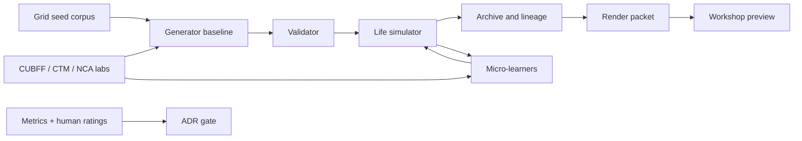
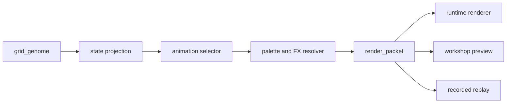
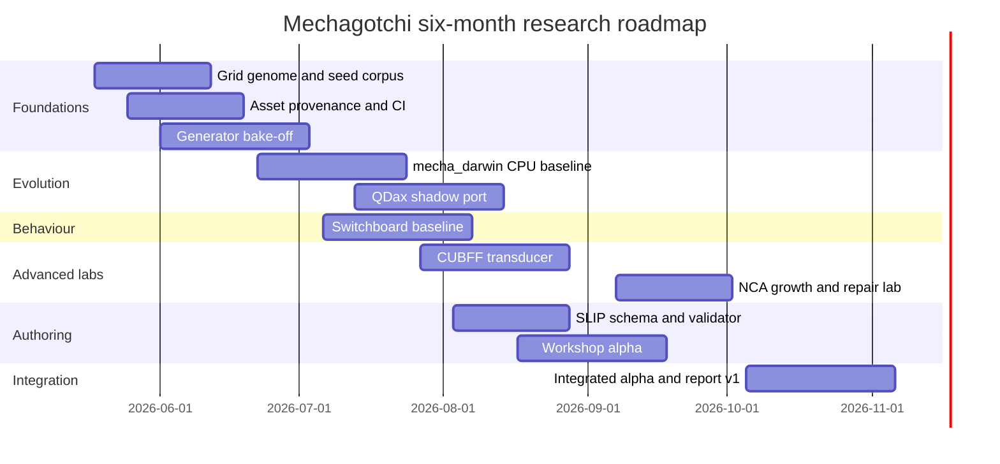

# Mechagotchi Research Dossier

## Executive summary

The strongest research framing for Mechagotchi is not “virtual pet with procedural sprites,” but a modular Artificial Life programme built on a **semantic grid genome**. In the most defensible architecture, the grid is simultaneously phenotype, mutation surface, rendering substrate, and lineage record. The evidence base favours a **hybrid stack** rather than a single algorithmic centre: local structure from a Markov chain or higher-order Markov model; hard validity from `Wave Function Collapse`-style constraint propagation and validators; growth and repair experiments from Cellular automaton and neural cellular automata; evolutionary search via `MAP-Elites`; and lightweight behavioural adaptation through contextual bandits, a Hidden Markov Model for latent mood, and small Markov decision process sandboxes.

The immediate recommendation is to **separate research baselines from advanced lab tracks**. The first production-grade research baseline should be: semantic grid genome → Markov/WFC hybrid generator → validator → life simulation → CPU-first `MAP-Elites` archive → render packet bridge → workshop/editor. Advanced lab tracks should then compete for admission into the core: CTM-inspired internal ticks and certainty-based adaptive compute, CUBFF/BFF semantic transduction, and neural cellular automata growth/repair. That sequencing preserves novelty while preventing the whole programme from becoming hostage to the most speculative components.

For the next six months, the programme should aim to answer four gating questions. First: can a formal grid genome and validator produce legible, modular, evolvable companions? Second: does a hybrid generator outperform random mutation and single-method baselines on validity, readability, and diversity? Third: does `mecha_darwin` produce a stable repertoire of different high-performing companion families rather than converging into one species? Fourth: do CUBFF and CTM concepts add enough measurable value to justify becoming first-class dependencies? Those gates are actionable, reproducible, and grounded in the source base below.

| Decision area | Recommended default | Why |
|---|---|---|
| Core substrate | Semantic grid genome + validator | Needed before any generator or archive can be evaluated consistently |
| Default generator | Markov + WFC/constraints + mutation | Strong balance of local coherence and hard validity |
| Evolution archive | CPU-first `MAP-Elites`; optional QDax shadow port | Preserve multiple species niches before optimising runtime |
| Behaviour layer | Rules baseline + contextual bandit + HMM mood model | Best fit for short lifecycles and sparse feedback |
| Advanced lab tracks | CUBFF transducer, NCA growth, CTM-inspired internal ticks | High novelty, but must earn admission through benchmarks |
| Authoring layer | Semantic pixel editor + `SLIP` validator | Generic sprite editors do not encode mutation or survival semantics |
| Legal posture | Original/CC0-first assets, SPDX + REUSE in CI | Keeps the research base reusable and auditable |

These defaults are the best starting point because the official PCG literature distinguishes constructive, search-based, mixed-initiative, and evaluation layers; WFC provides a precise local-constraint mechanism; MAP-Elites and QDax give a repertoire-oriented archive model; Avida and OntoAvida show the value of formal ontology plus provenance; and CTM/CUBFF each contribute strong ideas but also clear integration risk if adopted too early.

## Assumptions and operating model

This dossier assumes **open-ended constraints**, but it still needs a working baseline. The practical planning assumption is a core team of four to six roles, whether filled by four people or by fewer people wearing multiple hats: Research Lead, Applied Math / ALife Researcher, Engine Architect, Visual Systems Designer, Workshop / Tooling Designer, and Licensing / Provenance Maintainer. It also assumes that reproducibility is non-negotiable: every experiment should capture dataset version, Git SHA, seed, config hash, metric outputs, and artefact manifest, following the same general logic that makes OntoAvida useful for inference, provenance, and reproducibility, and that REUSE/SPDX make machine-readable licensing practical.

| Assumption | Working default |
|---|---|
| Runtime languages | Python 3.12 for research labs; Python engine core first; TypeScript/React for workshop |
| Experiment packaging | `research/`, `labs/`, `packages/`, `data/`, `docs/adr/`, `ops/assets/` |
| Reproducibility | fixed RNG seeds, JSONL metrics, Docker/conda manifests, dataset versioning |
| Compute tier low | laptop/desktop CPU, 16–32 GB RAM |
| Compute tier medium | single consumer GPU or 16-core CPU workstation |
| Compute tier high | multi-GPU or cloud JAX/CUDA budget |
| Source policy | primary/official sources first; reimplement from papers/repos before integrating |
| Asset policy | original or CC0 by default; copyleft/share-alike isolated into optional sandboxes |
| Review cadence | weekly literature/experiment review; monthly ADR decision gate |

The operating model should be **schema-first and experiment-first**. That means no subsystem graduates into `packages/` until it has a written experiment card, a baseline, a metric report, and an Architecture Decision Record. QDax’s separation of `container`, `emitter`, and `scoring_function` is a strong model for how `mecha_darwin` should be decomposed; OntoAvida demonstrates the payoff of an explicit vocabulary; and the PCG literature is clear that generator evaluation must be treated as a first-class part of the field rather than an afterthought.

The programme-wide pipeline should look like this:


That decomposition is consistent with the modular API philosophy in QDax, the provenance and reproducibility goals articulated in OntoAvida, and the multi-method framing of the PCG literature.

## Prioritized sources and mathematical stack

### Priority source pack

- Continuous Thought Machines paper and CTM repo — highest-value source for internal ticks, certainty-gated adaptive compute, and temporal neural dynamics. Use as conceptual inspiration for companion “thinking time,” not as a blocking dependency for v0 research.
- Computational Life paper and CuBFF repo — highest-value source for self-replication without an explicit fitness landscape, self-modification dynamics, and artificial-life substrate experiments. Use in a dedicated transducer lab, not as direct visual output.
- Avida official site, Avida repo, and OntoAvida paper — core references for digital evolution, experiment formalization, and ontology/provenance design.
- WaveFunctionCollapse repo — highest-value source for single-example local pattern extraction, low-entropy collapse, contradiction handling, and time-axis constraint ideas.
- Growing Neural Cellular Automata article and Growing NCA repo — strongest source for growth, regeneration, and locally updated morphology.
- MAP-Elites paper, QDax JMLR paper, QDax repo, and QDax docs — core source pack for the `mecha_darwin` repertoire and the scaling path from CPU baseline to accelerator-backed QD.
- Novelty Search paper — baseline source for deceptive-search avoidance and open-ended exploration.
- PCG Book — field map for constructive generation, search-based PCG, grammars, mixed-initiative tooling, and generator evaluation.
- SPDX License List, REUSE Software, Creative Commons Chooser, and OpenGameArt FAQ — required source pack for provenance and licence hygiene.
- Pixelorama repo, Piskel repo, LibreSprite repo, LPC style guide, LPC asset repo, and Lospec Palette List — workshop/editor and asset-style references only; not all are safe to embed directly.

These are the official or primary materials most worth anchoring the programme to. CTM and CUBFF each come with official repos under Apache-2.0; Avida is officially distributed under LGPL and now has an ontology paper centred on provenance and reproducibility; WFC’s official repo documents the algorithm directly; the Distill growing-NCA article and code are the canonical reference pair; and QDax provides both the scholarly paper and production-facing docs/repo needed for adoption decisions.

### Mathematical layers to explore

The structural layer should be benchmarked across Markov chain methods, Markov Random Field variants, Wave Function Collapse, Cellular automaton, Neural Cellular Automata, and Reaction-diffusion system. The behaviour and evolution layers should be benchmarked across Hidden Markov Model, contextual bandits, Markov decision process simulators, MAP-Elites, and Novelty Search.

| Candidate | Best role in Mechagotchi | Strengths | Weaknesses | Data need | Compute / implementation difficulty |
|---|---|---|---|---|---|
| Markov / higher-order Markov | Local body pattern generation, animation frame transitions | Simple, data-light, easy to debug, lineage-friendly | Weak global coherence unless paired with constraints | Low | Low |
| Markov Random Field | Grid denoising, local semantic regularization | Strong lattice formulation, principled local dependence | Inference cost higher than plain Markov; harder tooling | Low–medium | Medium |
| Hidden Markov Model | Hidden mood, latent behavioural state | Interpretable latent states, sequence-friendly | Limited expressive power for rich behaviour | Low | Low–medium |
| Wave Function Collapse | Hard local validity and body-plan coherence | Learns from examples, minimal-entropy search, explicit contradictions | Can fail via contradictions; sensitive to example corpus | Low | Medium |
| Classical CA | Damage spread, idle life, growth/glitch effects | Cheap, expressive local emergence | Hard to control semantically | Low | Low |
| Neural Cellular Automata | Growth, repair, persistent morphology | Regeneration and learned local update rules | Requires training loop and stronger infra | Medium | Medium–high |
| Reaction–diffusion | Ornamentation, scars, shell patterns, mood diffusion | Strong morphogenesis intuition, visually rich | Weak semantic controllability for body plans | Low | Low–medium |
| MAP-Elites | Species archive and diverse elite preservation | Preserves many good niches, excellent for “families” | Needs good behaviour descriptors | Low | Medium |
| Novelty Search | Deceptive-search baseline, exploration booster | Escapes objective traps, open-ended behaviour discovery | Can drift into useless novelty without guardrails | Low | Medium |
| QDax | Scaled QD execution | Accelerator-backed QD, modular API | Extra infra and JAX dependency; premature if semantics unstable | Low | Medium–high |
| Contextual bandits | Small online personalization loops | Good for sparse reward and short horizons | No long-horizon planning | Online interaction data | Low |
| MDP / small planning sandbox | Goal arbitration and action utility | Explicit planning formalism, useful in toy simulators | Requires clean state/action model; brittle if state is vague | Medium | Medium |

The source basis for this comparison is straightforward: Rabiner remains the standard HMM tutorial reference; Besag remains the key lattice-system reference for MRFs; Turing remains the classic morphogenesis reference for reaction-diffusion; WFC’s own repo documents the low-entropy collapse and contradiction model; Growing NCA is the canonical neural-cellular reference; MAP-Elites and Novelty Search are the canonical QD/open-ended search papers; and Sutton–Barto plus Li et al. cover the MDP and contextual-bandit foundations.

The immediate research recommendation is therefore:

| Layer | Default research baseline | Competing lab tracks | Decision rule |
|---|---|---|---|
| Body generation | Markov + WFC/constraints | MRF-lite post-processor, grammar layer, CA growth | Accept the smallest stack that clears validity + readability thresholds |
| Behaviour | Rules + contextual bandit + HMM | CTM-inspired timing, small MDP planner | Admit complexity only if it improves welfare or coherence materially |
| Evolution | CPU MAP-Elites | Novelty hybrid, QDax, later NCA-assisted descriptors | Port to QDax only after descriptors and metrics stabilize |
| Growth / repair | none in baseline | CA, NCA, reaction-diffusion overlays | Keep optional until body readability survives the layer |
| Artificial-life substrate | none in baseline | CUBFF semantic transducer | Keep out unless transduced outputs win benchmarks |

This recommendation follows from the source base directly: WFC is closer to a usable generator than CTM or CUBFF; MAP-Elites is intrinsically aligned with “many species, not one optimum”; and QDax is valuable once the archive design exists, not before.

## Experimental programme

A successful programme needs a **common evaluation spine** before stage-specific work starts. The evaluation framework should combine generator metrics from the PCG literature, repertoire/archive metrics from quality-diversity, provenance metrics from OntoAvida, and user-relationship quality metrics that go beyond raw retention. In particular, machine companionship should not be reduced to “stickiness”; Banks’ recent AI-companion scale highlights relational dimensions such as Eudaimonic Exchange and Connective Coordination, which are more defensible than crude session-time optimization.

| Evaluation criterion | Primary metric | Secondary metric | Default pass band |
|---|---|---|---|
| Structural validity | validator pass rate | false accept / false reject | ≥ 85% generated-valid and strong validator precision |
| Visual readability | blinded human rating | organ detectability, silhouette entropy | median ≥ 4/5 |
| Diversity | normalized Hamming distance / archive coverage | novelty score | better than random and no collapse |
| Ancestral continuity | parent–child trait retention | lineage depth | meaningful retention without cloning |
| Behavioural coherence | action oscillation rate | hidden-state stability | fewer oscillations than rules baseline |
| Companionship quality | coordination / exchange survey items | nuisance prompt rate | improves without manipulative behaviour |
| Reproducibility | rerun match by seed/config | artefact manifest completeness | deterministic replay for research runs |
| Licence cleanliness | files with known licence/provenance | CI failures | 100% declared in shipped artefacts |

The end-to-end experimental pipeline should look like this:



That structure allows each research track to compete on the same scorecard rather than being judged by aesthetics alone.

### Grid genome

The grid-genome stage should formalize the shared vocabulary of Mechagotchi before any serious procedural or evolutionary work begins. This is where OntoAvida is the most useful analogue: its main contribution is not a specific algorithm but the explicit formalization of terms, relations, provenance, and reproducibility. Besag’s lattice formulation, WFC’s local-pattern constraints, and CA/NCA’s neighbourhood updates all become far easier to test when the grid’s semantics are explicit rather than implicit.

| Item | Plan |
|---|---|
| Who | Research Lead; Engine Architect; Visual Systems Designer; Evaluation Lead |
| What | Define the genotype/phenotype contract for cells, organs, mutation permissions, palette rules, and renderability |
| How | Schema-first design; 50 original hand-authored seeds; invalid corpus; validator; mutation fuzzing |
| Where | `research/grid_genome/`, `labs/grid_genome/`, `packages/mecha_engine/genome/`, `docs/ontology/` |
| Why | Every later track depends on a stable, testable representation |
| Prototype spec | Python 3.12; Pydantic/JSON Schema; deterministic CLI validator; JSONL test logs |
| Deliverables | `grid_genome.schema.json`, `seed_50/`, `invalid_200/`, validator report, mutation operator spec |

| Experiment | Inputs | Expected outputs | Success threshold | Compute | Estimated time / effort |
|---|---|---|---|---|---|
| Invariant definition and validator training | 50 valid hand-authored grids; 200 invalid counterexamples | validator + labelled pass/fail cases | false accept ≤ 2%; false reject ≤ 5% | Low | 2 weeks / Medium |
| Conservative mutation stability harness | 50 seeds; 10 mutation ops; 100 offspring per seed | mutation survival report | ≥ 70% renderable offspring under conservative settings | Low | 1 week / Low |
| Human readability pilot | 200 grid renders; 8–10 raters | readability scores + comments | median readability ≥ 4/5 | Low | 1 week / Low |

This stage is successful when the rest of the programme can stop arguing about what a “valid Mechagotchi” is. WFC’s contradiction model, Besag-style lattice semantics, and OntoAvida-style explicit vocabulary make the validator the real foundation of the research stack.

### Grid generation bake-off

The generator selection stage should compare methods under a common corpus, common metrics, and identical seed conditions. WFC’s official description is especially useful here because it makes its assumptions and failure modes explicit: pattern extraction from a single example, lowest-entropy observation, propagation, and possible contradictions. The WFC repo also notes that the overlapping model is related to higher-order Markov chains and that one dimension can be time, which makes it unusually relevant for animation and state transitions in Mechagotchi.

| Item | Plan |
|---|---|
| Who | Applied Math Researcher; Engine Architect; Visual Systems Designer; Evaluation Lead |
| What | Benchmark random mutation, Markov, MRF-lite, WFC, grammar, CA growth, and hybrid pipelines |
| How | Fixed seed corpus; identical batch sizes; common metric dashboard; blinded human scoring |
| Where | `labs/markov_grid/`, `labs/wfc_grid/`, `labs/mrf_lite/`, `labs/grid_grammar/`, `labs/ca_growth/` |
| Why | The project needs evidence for the default generator stack rather than ideology |
| Prototype spec | CPU-first Python baseline; optional external WFC reference runs; 16×16 and 24×24 targets |
| Deliverables | benchmark report, generator comparison notebook, chosen-stack ADR |

| Experiment | Inputs | Expected outputs | Success threshold | Compute | Estimated time / effort |
|---|---|---|---|---|---|
| Generator benchmark | `seed_50`; 1,000 outputs per method | validity/readability/diversity report | valid rate ≥ 85%; readability ≥ 3.8/5; mean generation time ≤ 250 ms on CPU | Low–Medium | 3 weeks / Medium |
| Animation/time-axis benchmark | state-labelled frame seeds | valid short frame sequences | ≥ 80% transition validity and improved frame coherence over random animation | Medium | 1 week / Medium |
| MRF-lite regularization test | generator outputs + semantic maps | post-processed candidate set | readability uplift ≥ 0.3/5 without material diversity loss | Medium | 1 week / Medium |

The likely winner is a hybrid: Markov or higher-order local statistics for proposal generation, WFC/constraints for structural admissibility, and mutation/validator passes for lineage variation. That recommendation directly reflects the WFC repo, the PCG literature’s constructive/search distinction, and the strength of lattice-style local models in spatial systems.

### Mecha_darwin archive

`mecha_darwin` should be researched as a repertoire, not a single-objective optimizer. The core reason is the original MAP-Elites argument: illuminating a search space is often more useful than finding one best point. QDax is especially valuable here, not because it should be adopted immediately, but because its modular `container` / `emitter` / `scoring_function` decomposition gives a clean software design for the archive and also provides a later accelerator path once the descriptors stabilize. Novelty Search should be kept in the bake-off as the canonical deceptive-search baseline.

| Item | Plan |
|---|---|
| Who | Artificial Life Researcher; Applied Math Researcher; Engine Architect |
| What | Build the first species archive, descriptor space, and lineage graph |
| How | CPU-first MAP-Elites baseline; descriptor bake-off; novelty baseline; later QDax shadow port |
| Where | `labs/mecha_darwin/`, `packages/mecha_engine/archive/`, `research/descriptors/` |
| Why | Mechagotchi’s novelty depends on preserving many viable families, not one optimum |
| Prototype spec | Plain Python/Numpy first; archive stored as JSONL/Parquet; optional JAX/QDax mirror |
| Deliverables | descriptor spec, archive runner, lineage graph exporter, QD report |

| Experiment | Inputs | Expected outputs | Success threshold | Compute | Estimated time / effort |
|---|---|---|---|---|---|
| Descriptor-space design | generated companions + manual labels | descriptor config candidates | descriptor set selected with inter-rater interpretability ≥ 0.7 | Medium | 1 week / Medium |
| MAP-Elites vs novelty vs GA | fixed generator + simulator + 5 seeds | coverage, diversity, top fitness comparison | archive coverage ≥ 25% on a 576-cell repertoire after 20k evaluations; no single lineage > 40% of occupied cells | Medium | 2 weeks / Medium |
| QDax shadow port | winning descriptor config | speed and reproducibility comparison | ≥ 5× throughput or clearly better iteration speed before core migration | Medium–High | 1 week / Medium |

The research basis here is unusually strong: MAP-Elites provides the theory, QDax provides the modern execution model, and Novelty Search provides the required anti-deception comparator. If Mechagotchi wants “species memory,” this is the track that proves it.

### CUBFF transducer

CUBFF should be treated as a hidden substrate experiment, not a body generator. The `Computational Life` paper is explicit that self-replicators can arise in environments lacking an explicit fitness landscape, largely through self-modification, and that the dynamics are substrate-specific. That is potentially valuable for Mechagotchi, but your previous result already identified the main integration problem: raw CUBFF outputs are not automatically human-legible. The new research question is therefore whether CUBFF can drive **semantic traits** rather than pixels.

| Item | Plan |
|---|---|
| Who | Artificial Life Researcher; Applied Math Researcher; Visual Systems Designer |
| What | Test whether CUBFF/BFF dynamics can serve as a semantic transducer into Mechagotchi traits |
| How | Extract tape statistics, lineage events, and self-modification patterns into a trait vector |
| Where | `labs/cubff_transducer/`, `research/cubff_notes/`, optional isolated Docker/Nix env |
| Why | This is the most novel path in the programme, but also the easiest to waste time on if left unconstrained |
| Prototype spec | local `make CUDA=0` baseline first; optional CUDA runs later; Python bindings for trait extraction |
| Deliverables | transducer spec, baseline comparison report, go/no-go ADR |

| Experiment | Inputs | Expected outputs | Success threshold | Compute | Estimated time / effort |
|---|---|---|---|---|---|
| Direct mapping baseline | raw tape/program states | direct pixel or cell-role outputs | expected to fail visually; used only as baseline | Medium | 3 days / Low |
| Statistical transducer | replication rate, entropy, motif counts, lineage churn | trait vector → grid genome | readability improves by ≥ 1 point over direct baseline | Medium | 1 week / Medium |
| Behaviour-only transducer | CUBFF lineage events and instability signals | mutation pressure / temperament parameters | ≥ 10% survival or novelty improvement over no-CUBFF control | Medium | 1 week / Medium |
| Hybrid semantic compiler | CUBFF trait vector + Markov/WFC generator + validator | final candidate population | must beat direct baseline on readability and either novelty or survival across 10 seeds | Medium–High | 1 week / Medium |

The decision gate is simple: if semantic transduction does not materially beat direct mapping and baseline procedural mutation, CUBFF stays a background research note rather than part of the core engine. That protects the novelty of the project without letting novelty hijack delivery.

### Micro-learners and switchboard

The behaviour layer should be intentionally small-model and multi-threaded. CTM’s real contribution to Mechagotchi is not “use CTM”; it is the idea that cognition can unfold over internal time and be truncated by certainty. For a short-lifecycle companion engine, that principle is more useful than copying the full model. Pair that with contextual bandits for sparse online adaptation, HMMs for latent mood, and small MDP sandboxes for action arbitration in simplified state spaces.

| Item | Plan |
|---|---|
| Who | Engine Architect; Applied ML Researcher; Evaluation Lead |
| What | Build a switchboard that combines small predictive threads instead of a monolithic “brain” |
| How | Start with rules baseline, then add EWMA predictors, context bandits, HMM mood, and small MDP sandbox |
| Where | `labs/switchboard/`, `packages/mecha_engine/learning/`, `research/policies/` |
| Why | Lifecycles are short, feedback is sparse, and the system must remain interpretable |
| Prototype spec | event-loop simulator for 100k ticks; pluggable thread interface; action logs with confidence scores |
| Deliverables | switchboard API, learner cards, reward specification, ablation report |

| Experiment | Inputs | Expected outputs | Success threshold | Compute | Estimated time / effort |
|---|---|---|---|---|---|
| Rules-only baseline | scripted scenarios + replay logs | action and nuisance baseline | baseline established | Low | 3 days / Low |
| Contextual bandit action selection | context vectors + simple rewards | adaptive action preferences | cumulative welfare reward improves ≥ 15% over rules | Low | 1 week / Medium |
| HMM mood inference | observed state transitions | latent mood sequence estimates | reduced oscillation and improved state predictability | Low | 1 week / Medium |
| Small MDP sandbox | simplified 10–20 state world | policy comparison | meaningful gain only if long-horizon effects exceed bandit-only baseline | Low–Medium | 1 week / Medium |

This track is successful if the companion feels more alive **and** becomes more interpretable. CTM justifies the internal-tick idea; Sutton–Barto justify the bandit/MDP split; and Rabiner justifies hidden-state modelling where visible needs do not fully explain action selection.

### SLIP schema

`SLIP` should be treated as a mathematically meaningful profile, not a theme file. The closest useful analogue from the source base is OntoAvida’s emphasis on formal vocabulary, explicit relations, and reproducibility. In Mechagotchi terms, that means a `SLIP` object should encode constraints, priors, mutation permissions, behavioural weights, and validation rules, all under versioned schema control. The mixed-initiative and evaluation chapters in the PCG book further support making the authoring contract explicit.

| Item | Plan |
|---|---|
| Who | Engine Architect; Workshop Designer; Visual Systems Designer |
| What | Define the versioned `SLIP` schema, validator, and authoring affordances |
| How | schema design, profile zoo, compatibility testing, creator pilot |
| Where | `packages/mecha_engine/slip/`, `packages/mecha_workshop/slip_creator/`, `research/slip_schema/` |
| Why | The project’s modularity depends on `SLIP` being both expressive and safe |
| Prototype spec | JSON Schema + docs + form-based editor prototype; round-trip tests with engine |
| Deliverables | `slip.schema.json`, validator, 20 canonical profiles, fuzz test pack, compatibility report |

| Experiment | Inputs | Expected outputs | Success threshold | Compute | Estimated time / effort |
|---|---|---|---|---|---|
| Constraint expressiveness test | 20 intended species archetypes | schema revision list | all 20 can be represented without ad hoc fields | Low | 1 week / Medium |
| Fuzzing and invalid case testing | random profile objects + malicious cases | validator hardening report | false pass ≤ 1% on invalid corpus | Low | 3 days / Low |
| Creator pilot | 5–10 internal/external creators | usability + schema pain points | ≥ 90% of profiles validate within two edits; ≥ 80% generate a valid companion | Low | 1 week / Medium |

This stage succeeds when `SLIP` becomes a stable authorial contract between workshop and engine. Without it, “modularity” remains a slogan instead of a file format.

### Workshop and editor

The workshop should be researched as a **semantic pixel editor**, not merely a canvas. That is exactly where existing open-source editors are useful as references rather than drop-in solutions. Piskel is attractive for web-first architecture because it is built in JavaScript/HTML/CSS; Pixelorama is especially relevant because it already supports project metadata and command-line automation; LibreSprite is valuable to study for onion skinning and animation UX, but its GPL lineage makes embedding more restrictive.

| Item | Plan |
|---|---|
| Who | Workshop Designer; Visual Systems Designer; Front-end Engineer; Licensing Maintainer |
| What | Build a browser-first editor for semantic grids, animation states, and `SLIP` metadata |
| How | study existing UX; implement Mechagotchi-native semantic overlays; support import/export |
| Where | `packages/mecha_workshop/editor/`, `research/editor_ux/`, `ops/interoperability/` |
| Why | Generic sprite tools cannot encode organ roles, mutation weights, or survival semantics |
| Prototype spec | TypeScript/React + Canvas; layers; onion skin; semantic brush; metadata inspector |
| Deliverables | workshop alpha, usability script, round-trip test harness, interoperability report |

| Experiment | Inputs | Expected outputs | Success threshold | Compute | Estimated time / effort |
|---|---|---|---|---|---|
| Semantic vs plain editor test | 8 participants; same authoring task | task-time and error-rate comparison | semantic editor reduces invalid exports by ≥ 50% | Low | 1 week / Medium |
| Import/export fidelity test | PNG sheets, JSON metadata, animation states | round-trip fidelity report | 100% fidelity on canonical tests | Low | 3 days / Low |
| First-session usability study | create one creature + one `SLIP` | usability observations | first-time completion ≤ 45 minutes | Low | 1 week / Medium |

Pixelorama and Piskel are the best immediate references for architecture and metadata practice; LibreSprite is the best animation-UX reference but should remain a study source unless the project intentionally embraces GPL obligations.

### Asset provenance

Asset provenance is not a paperwork afterthought; it is part of the research substrate. SPDX provides standardized identifiers and canonical licence URLs, and REUSE provides a practical mechanism for file-level notices and machine-readable compliance. Creative Commons’ own chooser explicitly says CC tools are for copyrightable works and are **not** the recommended path for software, while OpenGameArt’s FAQ warns that CC-BY-SA derivatives must remain share-alike and that GPL-licensed art should be used only with very clear understanding of compatibility. LPC’s asset repo is especially instructive because it is dual-licensed under CC BY-SA 3.0 and GPL 3.0, making it useful for research sandboxes but risky as a casual default pack.

| Item | Plan |
|---|---|
| Who | Licensing / Provenance Maintainer; Research Lead; Build Engineer |
| What | Create a provenance ledger and CI gate for all external and internal assets |
| How | SPDX short IDs, REUSE headers, manifest generation, optional-pack separation |
| Where | `ops/assets/`, `ops/licenses/`, `data/asset_ledger/`, CI pipeline |
| Why | The project needs legally legible reuse, community confidence, and reproducible asset lineage |
| Prototype spec | YAML/JSON manifest generator + CI check + attribution report exporter |
| Deliverables | asset ledger, attribution generator, CI policy, optional copyleft-sandbox pack |

| Experiment | Inputs | Expected outputs | Success threshold | Compute | Estimated time / effort |
|---|---|---|---|---|---|
| Ledger completeness test | all imported files | manifest with licence/provenance | 100% shipped files declared | Low | 3 days / Low |
| Default-pack purity test | candidate core asset pack | compliance report | 0 unknown licences; no accidental copyleft assets in default build | Low | 3 days / Low |
| LPC sandbox isolation test | optional LPC-derived research pack | optional-pack policy | sandbox fully isolated from default build and clearly attributed | Low | 3 days / Low |

This stage is not optional. If a file cannot be traced, it cannot ship in the default build. SPDX and REUSE make that enforceable rather than aspirational.

## Data products and interface schemas

The programme should prefer **internal datasets first** because they keep semantics clean and licensing simple. External sources should be added only as clearly labelled sandboxes: LPC for style/interoperability studies, Lospec for palette exploration, and editor references for UX study rather than asset ingestion. OntoAvida is the right inspiration here because it treats ontology, provenance, and experiment configuration as first-class data products rather than incidental metadata.

| Dataset | Purpose | Creation method | Target size | Format |
|---|---|---|---|---|
| `mechaseed_50` | initial valid creature corpus | fully original hand-authored seeds | 50 creatures | JSON + PNG render |
| `mechaseed_200` | broader body-plan training/eval set | derived from `mechaseed_50` with curated variants | 200 creatures | JSON + PNG |
| `grid_invalid_200` | validator negative corpus | intentionally malformed grids | 200 cases | JSON |
| `mutationbench_5000` | mutation operator evaluation | generated offspring from seeds under fixed configs | 5,000 cases | JSONL |
| `animstate_300` | state-frame corpus | curated idle/blink/sleep/beg/ill sequences | 300 sequences | JSON + spritesheet |
| `slip_zoo_100` | profile compatibility suite | canonical `SLIP` profiles across archetypes | 100 profiles | JSON |
| `replay_100k_ticks` | behaviour and switchboard evaluation | simulated tick logs + interaction scripts | 100k ticks | JSONL / Parquet |
| `humanratings_v1` | readability and bond evaluation | blinded rating rounds | 1–2 studies | CSV + questionnaire export |
| `asset_ledger_v1` | provenance and attribution | manifest generation from CI | full project scope | YAML / JSON |

The render bridge should also be designed as a stable interface between back end and workshop/runtime. QDax’s modular decomposition is a useful software pattern here: generation, evaluation, and storage should be separable so the render bridge stays thin and future front ends remain swappable.



A minimal semantic grid sketch for testing should look like this:

```text
Legend: E=eye M=mouth S=shell J=joint .=empty

........
..SEES..
..SSSS..
..SSSS..
...MM...
..SJJ...
..S..S..
........
```

The design artefacts below are proposed starter schemas, not final standards.

```json
{
 "schema_version": "0.1.0",
 "grid_id": "mg_seed_001",
 "species_class": "proto_shell",
 "grid_size": [16, 16],
 "palette_id": "lcd_green_01",
 "symmetry": {
 "mode": "bilateral",
 "bias": 0.82
 },
 "cells": [
 {
 "x": 5,
 "y": 4,
 "role": "eye",
 "material": "sensor",
 "value": 1,
 "organ_id": "eye_left",
 "mutation_weight": 0.1,
 "animation_anchor": true
 },
 {
 "x": 10,
 "y": 4,
 "role": "eye",
 "material": "sensor",
 "value": 1,
 "organ_id": "eye_right",
 "mutation_weight": 0.1,
 "animation_anchor": true
 },
 {
 "x": 7,
 "y": 9,
 "role": "mouth",
 "material": "shell",
 "value": 1,
 "organ_id": "mouth",
 "mutation_weight": 0.2,
 "animation_anchor": true
 }
 ],
 "invariants": {
 "min_body_mass": 18,
 "requires_sensor_pair": true,
 "requires_animation_anchor": true,
 "connected_components_max": 1
 }
}
```

```json
{
 "schema_version": "0.1.0",
 "slip_id": "slip_rust_goblin_v1",
 "name": "Rust Goblin",
 "species_class": "goblin_mecha",
 "generator_priors": {
 "grid_size_min": [12, 12],
 "grid_size_max": [24, 24],
 "symmetry_bias": 0.7,
 "preferred_roles": ["eye", "shell", "joint", "antenna"],
 "forbidden_roles": ["wing"]
 },
 "behaviour": {
 "curiosity": 0.82,
 "neediness": 0.35,
 "sleepiness": 0.48,
 "mischief": 0.71
 },
 "survival_weights": {
 "fed": 0.2,
 "rested": 0.2,
 "clean": 0.1,
 "social": 0.15,
 "novelty": 0.15,
 "stability": 0.2
 },
 "mutation_permissions": {
 "palette_shift": 0.12,
 "organ_shift": 0.06,
 "limb_growth": 0.08,
 "symmetry_break": 0.02
 },
 "learning_toggles": {
 "allow_bandit_personalization": true,
 "allow_hidden_mood_model": true,
 "allow_archive_bias": true
 }
}
```

```json
{
 "schema_version": "0.1.0",
 "frame_id": "rp_001_000342",
 "companion_id": "mg_001",
 "tick": 342,
 "mood": "curious",
 "life_state": "idle",
 "grid_size": [16, 16],
 "palette_id": "lcd_green_01",
 "cells": [
 { "x": 5, "y": 4, "color": "#1d2b1d", "role": "eye" },
 { "x": 10, "y": 4, "color": "#1d2b1d", "role": "eye" },
 { "x": 7, "y": 9, "color": "#344c34", "role": "mouth" }
 ],
 "animation": {
 "clip": "idle_blink",
 "frame_index": 2,
 "anchors": ["eye_left", "eye_right", "mouth"]
 },
 "effects": ["scanline", "lcd_ghosting"],
 "ui_hints": {
 "show_hunger_icon": false,
 "show_sleep_icon": false,
 "show_attention_ping": true
 }
}
```

```json
{
 "schema_version": "0.1.0",
 "lineage_record_id": "lin_00921",
 "child_id": "mg_0921",
 "parent_ids": ["mg_0814", "mg_0816"],
 "generation_index": 18,
 "archive_niche": {
 "symmetry_bin": 4,
 "complexity_bin": 2,
 "neediness_bin": 1,
 "animation_bin": 3
 },
 "mutation_events": [
 { "type": "palette_shift", "delta": 0.08 },
 { "type": "organ_shift", "organ_id": "eye_left", "dx": 1, "dy": 0 }
 ],
 "survival_outcome": {
 "age_ticks": 14320,
 "death_cause": "energy_collapse",
 "fitness": 0.71,
 "user_bond": 0.64
 },
 "provenance": {
 "dataset_version": "mechaseed_200@2026-06-15",
 "config_hash": "sha256:example",
 "rng_seed": 44192
 }
}
```

```json
{
 "schema_version": "0.1.0",
 "archive_entry_id": "arc_0045_0021_0008_0012",
 "occupant_id": "mg_0921",
 "descriptor": {
 "symmetry": 0.78,
 "visual_complexity": 0.41,
 "neediness": 0.29,
 "animation_density": 0.63
 },
 "descriptor_bins": [4, 2, 1, 3],
 "fitness_components": {
 "survival": 0.74,
 "readability": 0.82,
 "novelty": 0.55,
 "bond": 0.64,
 "slip_alignment": 0.77
 },
 "fitness_total": 0.71,
 "parents": ["mg_0814", "mg_0816"],
 "created_at_tick": 987201
}
```

## Risk, legal posture, and provenance

The biggest non-technical risk is **category confusion**: code licences, content licences, repo licences, and derivative-asset obligations are not interchangeable. SPDX exists precisely to standardize licence identifiers and canonical licence URLs, and REUSE exists to make that information machine-readable at file level. Creative Commons itself warns against using CC tools as the standard licensing route for software, while OpenGameArt explicitly notes share-alike obligations for CC-BY-SA derivatives, DRM caveats, and uncertainty around how GPL art affects non-GPL projects. LPC is a vivid example because its repository is dual-licensed under CC BY-SA 3.0 and GPL 3.0.

| Code / asset source | Licence posture | Mechagotchi recommendation |
|---|---|---|
| CTM repo | Apache-2.0 | Safe to inspect and selectively reuse with notice preservation |
| CuBFF repo | Apache-2.0 | Safe for lab integration; keep isolated until semantic value is proven |
| WFC repo | MIT | Safe reference and implementation basis |
| QDax repo | MIT | Safe optional dependency once archive semantics stabilize |
| Avida | LGPL | Strong reference tool; embedding requires ordinary LGPL diligence |
| Growing NCA repo | CC-BY-4.0 | Treat as article/reference/reimplementation source, not casual runtime copy-paste |
| Piskel | Apache-2.0 | Safe UX/reference source for web editor ideas |
| Pixelorama | MIT | Safe reference source and interoperability target |
| LibreSprite | GPLv2 | Study UX only unless GPL obligations are intentionally accepted |
| LPC assets | CC BY-SA 3.0 and GPL 3.0 | Research sandbox only by default; do not mix casually into the default core asset pack |

Those recommendations are conservative by design. The safest default build should contain only original project material, clearly permissioned contributions, or CC0/public-domain material. Share-alike or GPL assets can still be valuable for comparative research or optional compatibility packs, but they should be isolated and explicitly labelled so they do not silently define the legal posture of the whole project.

The second major risk is **scientific drift**: CUBFF can produce fascinating substrate behaviour that contributes nothing to human legibility; WFC can produce contradictions or style overfitting; QD archives can be gamed by poor descriptors; and NCA layers can produce visually impressive but semantically unusable growth. That is why each track above has a hard admission gate and why the archive should start CPU-first before being optimized with QDax. WFC’s official repo openly documents contradiction states, and the quality-diversity literature is clear that descriptors determine what “diversity” means.

The third major risk is **companion-design ethics**. If the project ever starts optimizing only for retention, nudging frequency, or “clinginess,” it will undermine the stated goal of building something useful rather than merely sticky. The better posture is to optimize for legibility, coordinated interaction, and positive machine-companionship measures, while treating nuisance rate and over-attachment risk as negative constraints in evaluation. Banks’ recent companionship work is useful here because it offers a more careful measurement vocabulary than crude engagement metrics.

A practical risk register should therefore be maintained from day one:

| Risk | Signal | Impact | Mitigation | Gate |
|---|---|---|---|---|
| Validator too weak | malformed grids slip through | all downstream experiments polluted | labelled invalid corpus + CI | cannot proceed to bake-off |
| Generator unreadable | low readability scores | novelty without usefulness | hybridize with constraints; revise seed corpus | reject winning method |
| Archive collapse | one lineage dominates | “evolution” becomes clone search | revise descriptors and novelty pressure | archive redesign |
| CUBFF irrelevance | semantic transducer fails | lost research time | keep lab-isolated | no core admission |
| Switchboard thrashing | oscillatory actions | annoying companion behaviour | HMM smoothing; simpler action set | revert to simpler learner mix |
| Licence contamination | unknown / incompatible files in build | unusable open-source release posture | SPDX + REUSE + CI block | release blocked |
| Reproducibility failure | reruns diverge by seed/config | non-rigorous findings | config capture + fixed seeds + manifest | ADR rejected |

## Six-month roadmap

The six-month plan should be run as a sequence of overlapping research sprints, not a waterfall. Foundations need to finish early, but the archive, switchboard, and editor can overlap once the grid ontology stabilizes. The key principle is that every month ends with a decision gate, not just a status update.



| Window | Milestone | Required outputs | Decision gate |
|---|---|---|---|
| Late May to mid-June | Semantic foundation | grid schema, validator, seed corpus, invalid corpus | **Gate A:** grid ontology accepted or revised |
| June | Generator decision | bake-off report across Markov/WFC/CA/MRF-lite/hybrid | **Gate B:** choose default generator stack |
| Late June to July | Archive baseline | CPU `MAP-Elites`, descriptor set, lineage logging | **Gate C:** archive covers meaningful niches or redesign |
| July to August | Behaviour baseline | rules + bandit/HMM switchboard | **Gate D:** adaptive layer improves coherence/welfare or simplify |
| August | `SLIP` contract | stable schema, validator, creator pilot findings | **Gate E:** freeze `SLIP` v0.1 |
| August to September | Workshop alpha | semantic editor, preview, round-trip tests | **Gate F:** authoring flow passes first-session thresholds |
| July to August | CUBFF transducer | semantic transducer report | **Gate G:** core admission only if benchmark win is clear |
| October to early November | Integrated alpha | end-to-end engine + workshop + provenance + research report | **Gate H:** publish research alpha and select post-six-month priorities |

The recommended post-roadmap priority order is already implicit in those gates. If Gate B and Gate C pass, the project has a real engine thesis. If Gate G also passes, the project becomes genuinely novel in substrate terms. If Gate E and Gate F pass, the project becomes authorable by a real community. If any advanced track fails its gate, the programme should keep the simpler winning baseline and record the rejected approach as a formal negative result rather than silently dragging it forward. That is the most rigorous way to build something both novel and real.

---

## Sources

- <https://arxiv.org/abs/1504.04909>
- <https://arxiv.org/abs/2505.05522>
- <https://arxiv.org/pdf/2406.19108>
- <https://creativecommons.org/chooser/>
- <https://github.com/SakanaAI/continuous-thought-machines/>
- <https://github.com/mxgmn/WaveFunctionCollapse>
- <https://github.com/orama-interactive/pixelorama>
- <https://github.com/piskelapp/piskel>
- <https://pub.sakana.ai/ctm/paper/ctm.pdf>
- <https://qdax.readthedocs.io/en/latest/overview/>
- <https://spdx.org/licenses/>
- <https://www.cs.cmu.edu/~cga/behavior/rabiner1.pdf>
- <https://www.nature.com/articles/s41597-023-02514-3>
- <https://www.pcgbook.com/>
- <https://www.sciencedirect.com/science/article/pii/S0747563226000427>
